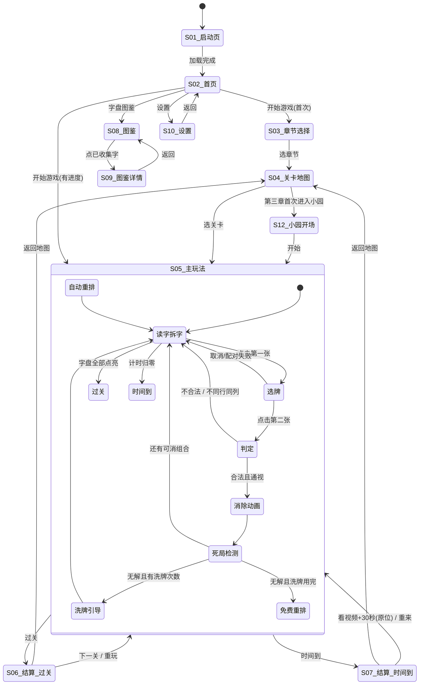

# 《挪字成章》游戏开发规格说明书（暂定名）

> **代号**：`chaizi-link` ｜ **版本**：GDD v2.2 ｜ **日期**：2026-10-01
> **平台**：微信小游戏（Canvas 2D 渲染）｜ **玩法类型**：休闲益智 · 汉字拆合 · 挪字合成
> **文档状态**：可交付开发（本文档 + `assets/wordlib.json` + `prototype/index.html` 构成完整交接包）

---

## 0. 文档说明

### 0.1 这份文档怎么用

| 角色 | 必读章节 |
| --- | --- |
| 主程 / 技术负责人 | 2、4、5、7、10、12 |
| 客户端开发 | 2、4、5、7.3、9、12 |
| 美术 / UI | 3.4、4.3、4.4、6 |
| 策划 / 内容 | 2、3、8、11 |
| 运营 / 商务 / 合规 | 1.5、8、9 |
| 只需要试玩验证 | 打开 `prototype/index.html` |

### 0.2 本稿已锁定的四个前提

| 序号 | 决策点 | 结论 | 影响面 |
| --- | --- | --- | --- |
| ① | **核心操作** | **挪对**：牌可以拖动，但**只能沿它自己所在的那一行或那一列滑动，遇到别的牌即停**；靠移动牌来创造「同行或同列且中间无阻挡」的配对条件。**不是画线连接** | 决定棋盘铺满率、操作手感、核心算法、可解性论证 |
| ② | 关卡结构 | 主题章节制（十八般兵器 / 花卉 / 逛三园 / 百工坊），每章 8 关 | 决定内容量与难度曲线 |
| ③ | 主体与变现 | 企业主体 + 纯广告（激励视频为主） | 决定合规路径 |
| ④ | 交付形态 | 开发规格说明书 + 可点击原型 + 字库数据资产 | 决定本轮交付物 |

#### ⚠️ v1 → v2 的玩法修订（重要）

| 项 | v1（作废） | v2（本稿） |
| --- | --- | --- |
| 核心动作 | 点两张牌，系统画线连接 | **拖动牌本身**，把牌挪到空位 |
| 消除判定 | 0 / 1 / 2 个折点，可绕棋盘外圈 | **只有 0 折点**：同行或同列，且中间无阻挡 |
| 棋盘 | 故意留 27%~45% 空格给连线用 | **接近铺满**（空置率 10%~30%），空格稀缺才有挪动策略 |
| 腾挪 | 独立的「腾挪」按钮 | **取消** —— 拖动本身就是腾挪 |
| 道具 | 提示 / 洗牌 | 提示 / 洗牌 / **凑对** |
| 难度控制 | 靠折点复杂度 | 靠**空位稀缺度 + 字库规模 + 部件混淆度** |

> 本稿依据《麻将挪对对》开发者公开的规则说明重写：① 相邻同款可直接点击消除；② 挪动一张牌后，若它与另一张可配对牌在同一行或同一列且能「直接连成一条线」，则两张一同消除。

### 0.3 术语表

| 术语 | 定义 |
| --- | --- |
| **挪对** | 拖动牌改变位置，使两张可配对的牌形成「同行 / 同列且中间无阻挡」的配对动作。本作核心动词 |
| **偏旁牌** | 显示形旁 / 部首的牌，暖色（赭黄）。如「木」「钅」「艹」 |
| **部件牌** | 显示另一部分的牌，冷色（青玉）。如「仓」「昆」「奉」 |
| **干扰牌** | 永远无法配对的废牌，灰墨色 + 斜线标记。如「疒」「匚」「彳」 |
| **通视** | 两张牌之间（不含两端）的所有格子都为空 |
| **配对表（RUN_PAIR）** | 本关允许的「偏旁 + 部件 → 目标字」映射，随关卡动态构建 |
| **求解器（findSuggest）** | 穷举「某张牌挪到某个空位后能否立即消除」的搜索函数，提示 / 死局检测 / 自动演示三处共用 |
| **一次一对** | 一次点击 / 一次拖动只消除它直接凑成的那一对；**没有自动连锁**（v2.1 起） |

### 0.4 一句话讲清这个游戏

**把一桌散落的偏旁和部件挪一挪，让能拼成一个字的两张牌落到同一行或同一列、中间不隔着别的牌，它们就会合体成一个汉字。**

不是连连看（牌不动、靠画线），是挪对（牌会动、靠位置）。

## 1. 立项总览

### 1.1 核心乐趣公式

```
核心乐趣 = 拆解的顿悟感  ×  连线的路径快感  ×  收集的完成欲
            ↑                  ↑                  ↑
     "原来枪是木+仓！"   画出一条拐两次的线      "这一章的字我全点亮了"
```

三层乐趣分别对应三个设计支柱，缺一不可：

| 支柱 | 对应的设计动作 | 如果没有它，游戏会变成 |
| --- | --- | --- |
| **拆解顿悟** | 顶部只给完整字（枪），强制玩家自己拆 | 退化成普通消除，失去题材灵魂 |
| **挪动规划** | 空格稀缺，一步只能挪一张，每步都是空间取舍 | 退化成"两个一组点掉"的无脑配对 |
| **收集完成** | 字盘点亮 + 图鉴 + 章节星级 | 缺乏长线动力，关卡打完即流失 |

### 1.2 目标用户与场景

| 维度 | 描述 |
| --- | --- |
| 主力人群 | 25–45 岁，有基本汉字识字量，喜欢轻量益智 |
| 场景 | 通勤、午休、睡前，单次 1–3 分钟，单关 60–180 秒 |
| 次主力人群 | 家长推给孩子（隐性教育场景：偏旁部首认知） |
| 明确不服务 | 硬核解谜玩家、需要强叙事的玩家、需要竞技对抗的玩家 |

> **产品定位提示**：这个游戏天然带"识字教育"属性，但**不要把它做成识字 APP**。教育价值应当作为"意外收获"存在，主体验必须是爽快的消除游戏。一旦在教育说教上加码，主力人群会流失。

### 1.3 与相邻品类的差异（先说清"不是什么"）

| 品类 | 核心动作 | 与本作的差异 |
| --- | --- | --- |
| 连连看 | 画线连接两张牌，线可有 0/1/2 折点、可绕外圈，**牌不动** | 本作**牌会动**，且只认「同行 / 同列且中间无阻挡」这一种关系（0 折点） |
| 三消 | 交换相邻两块，凑三连以上 | 本作是**二消**（两张成字），且可把牌挪到任意空格，不限于相邻交换 |
| 下落式消消乐 | 消除后上方方块下落补位 | 本作**不会下落**，位置完全由玩家决定，「挪到哪」就是策略本身 |
| 挪对对（本作机制来源） | 拖动牌，让两张**同款**同行 / 同列无阻挡后消除 | 本作把「两张同款」换成「**偏旁 + 部件**」，消除即**合成一个汉字**，并把合成的字作为收集目标 |
| 拼字 / 找字游戏 | 从候选里选出正确的组合 | 本作把「知识问答」变成「**空间规划**」，识字只是入场券，难点在怎么挪 |

**一句话定位**：用「挪对对」的手感，做「拆字」的知识型消除游戏。

### 1.4 形态边界：小游戏不是小程序（必须点明的坑）

这一节是给**没做过小游戏**的团队看的。用小程序经验做小游戏会连环踩坑：

| 维度 | 小程序 | 微信小游戏（本作） |
| --- | --- | --- |
| 入口文件 | `app.js` + 各页面 `.wxml/.wxss` | **`game.js` + `game.json`**，只有一个入口 |
| 渲染方式 | WXML/WXSS 是原生 DOM 式渲染 | **没有 WXML/WXSS**，一切靠自己用 **Canvas 2D / WebGL** 画 |
| 页面体系 | `wx.navigateTo` 页面栈 | **没有页面栈**，全部是自绘的场景（Scene），自己实现路由 |
| DOM 能力 | 有 | **无 DOM**，没有 `document`、`querySelector` |
| 包体限制 | 2MB/主包 | 主包 4MB，主包+分包合计 20MB（见 7.5） |
| 授权登录 | 类似 | 类似，但 `wx.login` 拿 code 换 openid 的逻辑要在游戏侧自建 |

> ⚠️ **给开发的第一个提醒**：`prototype/index.html` 是用 **HTML + DOM** 写的演示原型，**只是为了让你在浏览器里看页面结构和跳转关系**。真机实现必须用 **Canvas 2D 自绘**，DOM 那一套一行都搬不过去。原型里可以被复用的是**玩法逻辑（连通判定、字库、关卡配置）、布局比例、交互反馈时机**，不是它的实现方式。

### 1.5 上线前置条件摘要（详细见第 9 章）

| 条件 | 纯广告变现（本作方案） | 开通内购 |
| --- | --- | --- |
| 主体资格 | **个人或企业均可** | **必须企业**（版号申请主体不能是个人） |
| 软件著作权 | ✅ 必需（名称须与游戏名一致） | ✅ 必需 |
| 游戏自审自查报告 | ✅ 必需（含手写签名、日期） | ✅ 必需 |
| **游戏版号（ISBN）** | ❌ **不需要** | ✅ **必需** |
| ICP / 文网文 | ❌ 不需要 | ✅ 必需 |
| 虚拟支付能力 | ❌ 不可开通 | ✅ 开通 |

> 📌 **关键结论**：本作走纯广告变现，**在没有版号的情况下就可以上线**，这大幅降低了启动门槛。但代价是**一个虚拟支付接口都不能接**——包括任何形式的"付费解锁关卡/皮肤/道具"。所有变现必须走广告。
>
> 出处：微信开放社区《关于游戏小程序的资质问题》官方答复、微信小游戏接入指南；政策会更新，**提审前务必以国家新闻出版署与微信开放社区最新口径复核**。

### 1.6 游戏名候选（**需要需求方拍板**）

> ⚠️ 定名前必须做两件事：① 微信小游戏名称查重；② 中国商标网近似检索。
> ⚠️ **一级类目选定后不可修改**，且**软著名称必须与游戏名一致** —— 顺序反了要重办。

| 候选名 | 立意 | 提示 |
| --- | --- | --- |
| **挪字成章** | 挪动 + 成字，「成章」有文气 | 推荐。既点了核心动作，又有语感，不像工具名 |
| 挪字成章 | 直白说清玩法 | 最好懂，但偏「功能描述」，缺品牌感 |
| 一字千挪 | 「一字」点题拆字，「千挪」点题挪动 | 记忆点强，但初看不知所云 |
| 偏旁挪趣 | 突出偏旁与趣味 | 轻松向，偏儿童市场 |
| 字里挪春 | 化用「字里行间」 | 文艺，但玩法指向太弱，买量转化会差 |

**推荐次序：挪字成章 > 挪字成章 > 一字千挪。**

## 2. 玩法设计（核心）

### 2.1 玩法一句话

**把散落的偏旁和部件挪一挪，让能拼成一个字的两张牌落到同一行或同一列、中间不隔着别的牌 —— 它们就会合体成一个汉字。**

### 2.2 单局完整流程

| 步 | 玩家做什么 | 系统做什么 |
| --- | --- | --- |
| 1 | 进关，看顶部目标字（如「枪 棍 棒」） | 生成棋盘、启动倒计时 |
| 2 | 自己把目标字拆成偏旁 + 部件（枪 = 木 + 仓） | 前 3 关显示「拆法提示」条，第 4 关起收起 |
| 3 | 在盘面上找这两张牌 | 点未对齐的牌时高亮其候选搭档 |
| 4 | **拖动**其中一张（只能沿本行 / 本列滑、遇牌即停）或**点击**已对齐的牌 | 按住即高亮可达格；拖动中实时预判落点可行性 |
| 5 | — | 判定：可配对 + 同行/同列 + 中间无阻挡 → 合成 |
| 6 | — | 两牌飞向中点、浮现汉字、目标条 +1、已成字条追加拆解卡；**只消这一对** |
| 7 | 重复 3–6，直到所有有效牌消完 | 全部消除 → 结算 |
| 8 | — | 倒计时归零 → 失败，可看广告复活 +30s |

### 2.3 棋盘与牌

#### 2.3.1 棋盘网格

| 章节 | 棋盘 | 总格数 | 典型牌数 | 空置率 |
| --- | --- | --- | --- | --- |
| 第一章 · 木字营 | 6 × 5 | 30 | 21 → 26 | 13% ~ 30% |
| 第二章 · 花间集 | 6 × 6 | 36 | 25 → 32 | 11% ~ 31% |
| 第三章 · 逛三园 | 7 × 6 | 42 | 29 → 38 | 10% ~ 31% |
| 第四章 · 百工坊 | 7 × 7 | 49 | 33 → 44 | 10% ~ 33% |

**硬性约束（已写进生成器，自测脚本对 32 关全量校验通过）**：

- 每关**至少留 3 个空格** —— 没有空格就没有挪动空间，玩法直接失效
- 牌数 = `pairs × 2 + junk`（pairs 为配对数，junk 为干扰牌数）
- 偏旁牌数量 = 部件牌数量 = `pairs`

#### 2.3.2 三种牌

| 类型 | 视觉 | 说明 | 能否配对 |
| --- | --- | --- | --- |
| **偏旁牌** | 赭黄暖色、木牌质感 | 显示形旁 / 部首（木、钅、艹…） | 只能与部件牌配 |
| **部件牌** | 青玉冷色、玉牌质感 | 显示另一部分（仓、昆、奉…） | 只能与偏旁牌配 |
| **干扰牌** | 灰墨色 + 斜线划痕 | 永远配不上的废牌，用来占位、堵路 | 永不参与配对 |

**为什么要有干扰牌**：如果盘面上全是可消的牌，就变成"随手挪都能消"。干扰牌提供**空间阻力**，是难度调节阀。干扰牌不需要消除，**过关条件只看有效牌是否消完**。

#### 2.3.3 牌面字号

牌面边长 = 格边长 − 间隙；字号 = 牌边长 × 0.54。6 列时格边长约 58px、字号约 29px（楷体）。

### 2.4 消除判定规则（★ 本节是核心，实现时逐字对照）

**唯一判定**：两张牌 A、B 满足以下**全部**条件，即可消除。

| 条件 | 说明 |
| --- | --- |
| ① 配对合法 | A 与 B 能组成本关字库里的某个目标字（一偏旁 + 一部件） |
| ② 同轴 | A 与 B 位于**同一行**，或位于**同一列** |
| ③ 通视 | A 与 B 之间（不含两端）的所有格子必须为空 |

**明确排除（v1 的错误做法，v2 不再实现）**：

- ❌ **折点**：不存在 1 折点、2 折点路径
- ❌ **绕外圈**：不能从棋盘外部绕行
- ❌ **对角**：不同行也不同列的两张牌，永远消不掉

#### 2.4.1 三种典型情况

```
可消（同行，中间空）        可消（同列，中间空）        不可消（中间被挡）
· A · · B ·                · A ·                      · A · X · B ·
                           · · ·                      （X 挡住了通视）
                           · · ·
                           · B ·
```

#### 2.4.2 判定算法（伪代码，供开发直接落地）

```js
// 1) 配对合法
function canPair(a, b){
  if (!a || !b || a === b) return false;
  if (a.kind === 'junk' || b.kind === 'junk') return false;
  if (a.kind === b.kind) return false;          // 必须一偏旁 + 一部件
  return !!RUN_PAIR[a.char + '|' + b.char];     // 本关配对表
}

// 2) 通视：同行或同列，中间全空
function lineClear(a, b){
  if (a.r === b.r){
    const l = Math.min(a.c, b.c), h = Math.max(a.c, b.c);
    for (let c = l + 1; c < h; c++) if (tileAt(a.r, c)) return false;
    return true;
  }
  if (a.c === b.c){
    const l = Math.min(a.r, b.r), h = Math.max(a.r, b.r);
    for (let r = l + 1; r < h; r++) if (tileAt(r, a.c)) return false;
    return true;
  }
  return false;                                  // 不同行也不同列
}

// 3) 找出某张牌当前所有可消对象
function matchTargets(t){
  const out = [];
  for (const o of allTiles()){
    if (o === t || !canPair(t, o)) continue;
    if (lineClear(t, o)) out.push(o);
  }
  return out;
}
```

复杂度：`lineClear` 为 O(max(列数, 行数))，`matchTargets` 为 O(牌数 × 行列数)，本作规模下可忽略。

### 2.5 配对合法性规则（★ 本作的灵魂）

1. **只看组合，不看左右**：`木 + 仓` 与 `仓 + 木` 等价，都是「枪」。形旁在右的字（如 `鸽 = 合 + 鸟`）同样成立。
2. **同类型永远不配**：`木 + 木` 无效、`仓 + 昆` 无效 —— 这条让玩家「找同款」的肌肉记忆失效，逼他真去想拆字。
3. **一偏旁可配多部件**：`木 + 仓 = 枪`、`木 + 昆 = 棍`、`木 + 奉 = 棒`。盘面上往往有十几张「木」，配哪张、先配哪个，就是策略空间。
4. **仅限本关字库**：配对表随关卡动态构建。第 1 关只有「枪棍棒」，那么 `木 + 每`（梅）在这一关就是**无效**的 —— 尽管字典上成立。这是控制难度的关键闸门。
5. **干扰牌永不参与**：任何含干扰牌的组合都返回 false。

#### 2.5.1 为什么顶部只给「完整的字」而不给零件

顶部目标条显示的是**成品字**（枪 / 棍 / 棒），不给「木」「仓」。玩家必须自己完成「枪 → 木 + 仓」这一步拆解。

这是本作区别于普通消除游戏的地方：**消除只是手段，拆字才是内容**。如果直接给零件，游戏会退化成"挪两张一样的牌"，识字价值归零。

#### 2.5.2 新手桥接（解决"给完整字太难"的问题）

| 关卡 | 提示强度 |
| --- | --- |
| 1-1 ~ 1-3 | 棋盘上方常驻「拆法提示」条：`木 + 仓 = 枪` |
| 1-4 起 | 提示条收起，靠玩家自己拆 |
| 任何时候 | 点一张未对齐的牌 → 高亮它的候选搭档（给方向，不给答案） |
| 卡住时 | 「提示」道具给出一句具体的挪法指引 |

### 2.6 操作定义：拖动与点击

#### 2.6.1 拖动（主操作）

| 阶段 | 表现 |
| --- | --- |
| 按住 | 牌抬起：放大 1.1 倍、随拖动方向轻微倾斜（±6°）、投影加深、置顶；**同时点亮本行 / 本列所有能滑到的空格** |
| 拖动中 | 牌被**锁定在一条轴上**（横向拖得多就横滑，纵向拖得多就竖滑），一格一格吸附前进；**实时预判**：若当前落点能让它与某张牌凑成对 → 搭档牌金色发光 + 两牌之间画金色流动虚线 |
| 松手 · 落在可达空格 | 牌吸附到位并**立即判定**；能配则消除，不能则**保留位置**（这次挪动"白挪了"，这正是策略点） |
| 松手 · 无可达空格（被围死） | 回弹原位 + 抖动 + 提示「这张牌上下左右都被挡住了，先把它旁边的牌挪开」 |

#### 2.6.2 ★ 滑动范围（v2.2 核心约束）

**一张牌只能沿「它自己所在的那一行、或那一列」滑动，且不能跨越别的牌**——朝某个方向扫过去，碰到牌就停，更远的格子够不着。

| 规则 | 说明 |
| --- | --- |
| 方向 | 只有横向 / 纵向两种。由玩家拖动的**主轴**决定（横向位移更大就横滑，反之竖滑），锁定后整段拖动不再改轴 |
| 距离 | 从自身位置沿该方向连续的空格；**碰到第一张牌即止**，不能跳过去 |
| 斜向拖动 | 仍按主轴吸附（斜着拖 3 格 × 1 格，牌只横移 3 格），**绝不会斜着落到别的行 / 列** |
| 被围死 | 四向紧邻都有牌时，这张牌完全无法移动（抖动 + 明确文案，避免玩家误以为卡 bug） |
| 视觉反馈 | 按住瞬间，本行 / 本列能滑到的空格亮起（金色描边 + 中心点）；松手即清除 |

**为什么加这条（v2.2 修订）**：v2.1 允许把牌拖到盘面任意空位，等于"无限自由重排"，策略层被抹平——玩家可以先在脑子里规划好，再一次性摆到位，中间没有任何阻力。加上滑动约束之后：

- **挡路的牌必须先挪开**，"先清路、再成对"成为一条真实存在的操作链路；
- **空格的价值被放大**：能滑到哪，完全取决于这一行 / 这一列的空格分布；
- 与参考游戏的「挪」字手感一致：牌是一格一格推过去的，不是瞬移。

> ⚠️ **一处实现，四处共用**：`slideRange(t)` 是唯一真源 —— 拖动限制、提示道具、死局检测、自动演示**全部**调用它。
> 否则会出现最难受的一类 bug：*提示让你挪到某个格子，但拖动时根本过不去*。这类"规则打架"比没有提示更伤信任。

#### 2.6.3 点击（快捷操作）

| 情形 | 行为 |
| --- | --- |
| 已对齐（与某张可配对牌同行 / 同列且通视） | **直接消除**（对应官方规则的"相邻同款点击即消"） |
| 未对齐 | 提示「它和「仓」能拼成字，但不在同一行、也不在同一列」，并高亮所有候选搭档 1.3 秒 |
| 点到干扰牌 | 抖动 + 提示「这是干扰牌，拼不成字」 |

#### 2.6.4 为什么点击也能消「同行隔着空格」的牌

严格照官方规则，只有"相邻"才能点击消除。但本作盘面铺满、空格少，若"明明已经通视却还要再拖一下"会显得莫名其妙。因此把点击的适用条件放宽为与拖动**同一套判定**（同行 / 同列 + 通视）。

这不降低难度（通视本身就是要挪出来的），但手感顺得多。

### 2.7 消除节奏：一次操作只消一对（v2.1 修订）

**不做自动连锁。** 一次点击 / 一次拖动，只消除它直接凑成的那一对，其余已对齐的对留在盘上，由玩家自己出手。

> **为什么砍掉连锁**：v2.0 曾实现"落位后把盘上所有已对齐的对连续消完"。实测下来有两个硬伤：
> ① **游戏自己玩自己** —— 开局只要恰好有 3 对对齐，玩家点一下就连消 3 对，操作感被稀释；
> ② **锁死时间过长** —— 每对之间约 0.48s，连消 3 对就是 1.4s 的 `busy` 锁，期间所有输入被吞掉，玩家会以为"点不动了"（这正是本轮"原型没法玩"的直接诱因之一）。
>
> 改为"一次一对"后：每次消除都是一次明确的玩家决策，节奏可控，也不会出现长时间无响应。

动画时序不变：双牌飞向中点（0.18s）→ 合成字浮现并放大（0.34s）→ DOM 移除 + 解锁操作（0.48s）。

- 消除过程中输入被屏蔽（`G.busy` 锁），避免状态错乱
- 解锁后立即调用 `checkDeadlock()`，若已无可凑的对则点亮洗牌按钮

### 2.8 死局检测与兜底

| 项 | 定义 |
| --- | --- |
| **死局** | 盘面上既没有「点一下就能消」的对（`hasDirectMatch() === false`），也找不到任何「挪一步就能消」的挪法（`findSuggest() === null`） |
| **检测时机** | 每次挪动后未触发消除时；使用洗牌后 |
| **兜底 A**（还有洗牌次数） | 洗牌道具按钮发光 + 提示「已无可立即凑成的挪法，用洗牌重置盘面」 |
| **兜底 B**（洗牌次数已用尽） | **自动免费重排一次** + 提示「自动为你重排盘面」 |

> ⚠️ **极易做错的一点**：判断死局前**必须先调用 `hasDirectMatch()`**。否则会把「场上明明有一对已经对齐、点一下就消」的局面误报成死局，玩家会认定游戏出 bug。

> ⚠️ **v2.2 新增：兜底 B 不是可选项。** 加了滑动约束之后，死局是**结构性**的（见 7.3.3），出现概率不再可忽略（实测盲玩约 0.75 次/局）。
> 如果只做兜底 A，一旦玩家的洗牌次数用完，就会**永久卡在一个什么都做不了的盘面上**，只能退出重来 —— 这是必现的差评点。

### 2.9 星级与失败

| 星级 | 条件 |
| --- | --- |
| 3 星 | 通关且剩余时间 > 50% |
| 2 星 | 剩余时间 > 20% |
| 1 星 | 在时限内通关即可 |
| 失败 | 倒计时归零。可看激励视频**复活 +30 秒**，复活后计时器从 30s 重新开始 |

结算页展示本关所用字的**拆解卡**（`木 + 仓 ＝ 枪`）—— 这是本作最有价值的一屏，玩家在这里真正记住这个字是怎么拆的。

### 2.10 道具

| 道具 | 效果 | 初始 | 补充方式 |
| --- | --- | --- | --- |
| **提示** | 优先指出「已对齐、点一下就能消」的那一对；若没有，则给一步可行挪法（青色 = 直接消，金色 = 挪一步） | 3 | 激励视频 +2 ／ 每日登录 |
| **洗牌** | **保持牌堆不变**，仅把现有牌重新随机布局，用于打破死局 | 1 | 激励视频 +1 |
| **凑对** | 无视位置限制，直接合成场上任意一对可配对的牌 | 1 | 激励视频 +1 |

### 2.11 关卡数值表

#### 2.11.1 章节棋盘与配比

| 章节 | 棋盘 | 总格 | 目标字 | 配对数 pairs | 干扰牌 junk | 实际牌数 | 剩余空格 |
| --- | --- | --- | --- | --- | --- | --- | --- |
| 第一章 · 木字营 | 6 × 5 | 30 | 3 → 5 | 9 → 11 | 3 → 4 | 21 → 26 | 4 → 9 |
| 第二章 · 花间集 | 6 × 6 | 36 | 3 → 5 | 11 → 14 | 3 → 4 | 25 → 32 | 4 → 11 |
| 第三章 · 逛三园 | 7 × 6 | 42 | 3 → 5 | 13 → 17 | 3 → 4 | 29 → 38 | 4 → 13 |
| 第四章 · 百工坊 | 7 × 7 | 49 | 3 → 5 | 15 → 20 | 3 → 4 | 33 → 44 | 5 → 16 |

> 配对数由「铺满率 = 0.70 + 关卡序号 × 0.028」推导，并硬性夹在「每关至少留 3 个空格」的上限内。**原型与本文档已对齐**（自测脚本对 32 关全量校验）。

#### 2.11.2 章节内难度递进曲线

以第一章为例（8 关）：

| 关卡 | 目标字 | 偏旁 | 引入的新东西 | 限时 |
| --- | --- | --- | --- | --- |
| 1-1 | 枪 棍 棒 | 木 | 基础操作 + 常驻拆法提示条 | 150s |
| 1-2 | 枪 棍 棒 | 木 | 配对数 +2 | 146s |
| 1-3 | 枪 棍 棒 杖 | 木 | 出现第 4 个字 | 142s |
| 1-4 | 枪 棍 棒 杖 柄 | 木 | **撤掉拆法提示条** | 138s |
| 1-5 | 锤 钩 镰 锏 | **钅** | **偏旁置换点**：打破"找木字旁"的肌肉记忆 | 134s |
| 1-6 | 锤 钩 箭 鞭 | 钅 竹 革 | 多偏旁混排 | 130s |
| 1-7 | 斧 弩 剑 靶 鞘 | 父 奴 刂 革 | 上下结构 + 形旁在右的字混入 | 126s |
| 1-8 | 枪 棍 锤 箭 斧 | 木 钅 竹 父 | **综合关**，无新机制，纯考验熟练度 | 120s |

> **难度设计说明**：1-5 是一个刻意的「偏旁置换点」。玩家在 1-1 到 1-4 用木字旁建立了一套"先扫木字旁"的视觉习惯，1-5 突然全换成金字旁，惯性被打断，注意力重新激活。这是防止前 6 关流失的关键手段。

### 2.12 章节与题材线路

#### 2.12.1 四章主线

| 章 | 名称 | 题材 | 偏旁池 | 原型演示字数 |
| --- | --- | --- | --- | --- |
| 一 | 木字营 | 十八般兵器 | 木 / 钅 / 竹 / 革 / 父 / 奴 / 刂 | 18 |
| 二 | 花间集 | 花卉草木 | 木 / 艹 | 8 |
| 三 | 逛三园 | 果园 / 动物园 / 植物园 | 木 / 艹 / 鱼 / 虫 | 6 |
| 四 | 百工坊 | 民俗器物 | 钅 / 火 / 虫 | 6 |

> 「原型演示字数」指可点击原型中内置的演示子集；**完整版字库见第 3 章（4 章共 103 字）**。原型用演示子集跑通 32 关，正式开发按第 3 章字库配置关卡。

#### 2.12.2 「逛三园」怎么落地（★ 需求方指定参考的思路）

「逛三园」是儿歌接龙的经典玩法 ——「星期天，逛三园，什么园？动物园」。本作把它改造成**章节主题**而非具体玩法：

- **第三章的 8 关依次对应**：植物园 → 果园 → 动物园 → 水族馆 → 昆虫馆 → 综合游园
- 每进一个新「园」，插屏一张**开场卡**（S12）：园门水墨图 + 一句童谣式念白
- 结算时用「园」的口吻道白，例如：「恭喜你，这园的门票集齐了」
- 这一章是**节奏缓冲章**：前两章是兵器与花卉（字形偏难），第三章的鱼虫字更直观，给玩家一次"轻松通关"的爽感，为第四章的器物字（结构最复杂）做体力储备

#### 2.12.3 内容扩展路线图

| 批次 | 主题 | 偏旁 | 预估字数 |
| --- | --- | --- | --- |
| 第三批 | 天气与自然 | 氵 冫 雨 | 20 |
| 第四批 | 心情与人体 | 忄 扌 目 口 | 24 |
| 第五批 | 交通与建筑 | 车 舟 阝 门 | 20 |

## 3. 拆字字库设计（★ 本作第一号难点）

### 3.1 拆字规范

本作取用**形声字**的「形旁 + 声旁」二分结构，理由：

| 结构类型 | 是否收录 | 说明 |
| --- | --- | --- |
| 左右结构（`lr`） | ✅ 收录 | 占绝对多数，如 枪 = 木 + 仓 |
| 上下结构（`tb`） | ✅ 收录 | 如 箭 = 竹 + 前、斧 = 父 + 斤、李 = 木 + 子 |
| 半包围 / 全包围 | ❌ 暂不收录 | 如 阀、固，拆分方向不直观，玩家会困惑"该往哪个方向连" |
| 独体字 | ❌ 不收录 | 如 弓、刀、水，本身就是偏旁，无法再拆 |
| 三部件及以上 | ❌ 首版不收录 | 如 想（相+心+…）、树（木+又+寸）。**留作扩展包的进阶玩法** |

> **判定原则一句话**：**如果这个字的两半能各自独立成字或至少能被一眼认出，就收；如果拆出来是个谁也不认识的偏旁，就不收。**

### 3.2 字库总表

> 数据源：`assets/wordlib.json`（本文档与该文件必须保持一致，改数据先改 JSON）。
> 结构：`lr` = 左右结构、`tb` = 上下结构。难度 tier 1 = 常见，2 = 中等，3 = 需要想一下。

#### 第一章 · 十八般兵器（19 字，8 关）

| 字 | 偏旁 | 部件 | 拼音 | 结构 | 释义 | tier |
| --- | --- | --- | --- | --- | --- | --- |
| 枪 | 木 | 仓 | qiāng | lr | 长柄刺击的兵器 | 1 |
| 棍 | 木 | 昆 | gùn | lr | 棒状的兵器 | 1 |
| 棒 | 木 | 奉 | bàng | lr | 较粗的棍子 | 1 |
| 杖 | 木 | 丈 | zhàng | lr | 手杖，也可作兵器 | 1 |
| 柄 | 木 | 丙 | bǐng | lr | 器物的把儿 | 1 |
| 槌 | 木 | 追 | chuí | lr | 敲打的用具 | 2 |
| 杵 | 木 | 午 | chǔ | lr | 捣物的棒槌 | 2 |
| 锤 | 钅 | 垂 | chuí | lr | 金属敲击兵器 | 2 |
| 钩 | 钅 | 勾 | gōu | lr | 弯曲带尖的兵器 | 2 |
| 镰 | 钅 | 廉 | lián | lr | 割草的弯刀 | 3 |
| 锏 | 钅 | 间 | jiǎn | lr | 古代的一种短兵器 | 3 |
| 箭 | 竹 | 前 | jiàn | **tb** | 搭在弓上发射的武器 | 2 |
| 鞭 | 革 | 便 | biān | lr | 长条形软兵器 | 3 |
| 鞘 | 革 | 肖 | qiào | lr | 装刀剑的套子 | 3 |
| 靶 | 革 | 巴 | bǎ | lr | 射击练习的目标 | 3 |
| 斧 | 父 | 斤 | fǔ | **tb** | 劈砍用的工具或兵器 | 3 |
| 弩 | 奴 | 弓 | nǔ | **tb** | 用机关射箭的弓 | 3 |
| 剑 | 佥 | 刂 | jiàn | lr | 双刃的直兵器 | 3 |
| 铠 | 钅 | 岂 | kǎi | lr | 护身的铁甲 | 3 |

#### 第二章 · 百花园（20 字，8 关）

| 字 | 偏旁 | 部件 | 拼音 | 结构 | 释义 | tier |
| --- | --- | --- | --- | --- | --- | --- |
| 花 | 艹 | 化 | huā | tb | 植物的花朵 | 1 |
| 莲 | 艹 | 连 | lián | tb | 荷花 | 1 |
| 莉 | 艹 | 利 | lì | tb | 茉莉 | 1 |
| 茉 | 艹 | 末 | mò | tb | 茉莉 | 1 |
| 蓉 | 艹 | 容 | róng | tb | 芙蓉 | 2 |
| 苇 | 艹 | 韦 | wěi | tb | 芦苇 | 2 |
| 萍 | 艹 | 平 | píng | tb | 浮萍 | 2 |
| 萝 | 艹 | 罗 | luó | tb | 藤萝 | 2 |
| 蕾 | 艹 | 雷 | lěi | tb | 含苞未放的花 | 3 |
| 荷 | 艹 | 何 | hé | tb | 荷花 | 3 |
| 桃 | 木 | 兆 | táo | lr | 桃树，桃花 | 1 |
| 柳 | 木 | 卯 | liǔ | lr | 柳树 | 1 |
| 梅 | 木 | 每 | méi | lr | 梅花，梅树 | 1 |
| 桂 | 木 | 圭 | guì | lr | 桂花树 | 2 |
| 枫 | 木 | 风 | fēng | lr | 枫树 | 2 |
| 桦 | 木 | 华 | huà | lr | 白桦树 | 2 |
| 樱 | 木 | 婴 | yīng | lr | 樱花，樱桃 | 3 |
| 松 | 木 | 公 | sōng | lr | 松树 | 1 |
| 柏 | 木 | 白 | bǎi | lr | 柏树 | 1 |
| 桐 | 木 | 同 | tóng | lr | 梧桐，泡桐 | 2 |

#### 第三章 · 逛三园（40 字，12 关）

**果园（11 字）**

| 字 | 偏旁 | 部件 | 拼音 | 结构 | 释义 | tier |
| --- | --- | --- | --- | --- | --- | --- |
| 杏 | 木 | 口 | xìng | tb | 杏树，杏子 | 1 |
| 李 | 木 | 子 | lǐ | tb | 李子 | 1 |
| 柿 | 木 | 市 | shì | lr | 柿子 | 1 |
| 柚 | 木 | 由 | yòu | lr | 柚子 | 1 |
| 柑 | 木 | 甘 | gān | lr | 柑橘 | 2 |
| 橙 | 木 | 登 | chéng | lr | 橙子 | 2 |
| 榴 | 木 | 留 | liú | lr | 石榴 | 3 |
| 柠 | 木 | 宁 | níng | lr | 柠檬 | 2 |
| 蕉 | 艹 | 焦 | jiāo | tb | 香蕉 | 2 |
| 莓 | 艹 | 每 | méi | tb | 草莓 | 2 |
| 蔗 | 艹 | 庶 | zhè | tb | 甘蔗 | 3 |

**动物园（19 字）**

| 字 | 偏旁 | 部件 | 拼音 | 结构 | 释义 | tier |
| --- | --- | --- | --- | --- | --- | --- |
| 猫 | 犭 | 苗 | māo | lr | 家猫 | 1 |
| 狗 | 犭 | 句 | gǒu | lr | 犬 | 1 |
| 狐 | 犭 | 瓜 | hú | lr | 狐狸 | 1 |
| 狼 | 犭 | 良 | láng | lr | 狼 | 1 |
| 猴 | 犭 | 侯 | hóu | lr | 猴子 | 2 |
| 狮 | 犭 | 师 | shī | lr | 狮子 | 2 |
| 猪 | 犭 | 者 | zhū | lr | 猪 | 2 |
| 狸 | 犭 | 里 | lí | lr | 狸猫 | 2 |
| 鸽 | 合 | 鸟 | gē | lr | 鸽子 | 2 |
| 鹅 | 我 | 鸟 | é | lr | 鹅 | 2 |
| 鹊 | 昔 | 鸟 | què | lr | 喜鹊 | 3 |
| 鸭 | 甲 | 鸟 | yā | lr | 鸭子 | 2 |
| 蚂 | 虫 | 马 | mǎ | lr | 蚂蚁 | 2 |
| 蚁 | 虫 | 义 | yǐ | lr | 蚂蚁 | 2 |
| 蜘 | 虫 | 知 | zhī | lr | 蜘蛛 | 3 |
| 蛛 | 虫 | 朱 | zhū | lr | 蜘蛛 | 3 |
| 鲤 | 鱼 | 里 | lǐ | lr | 鲤鱼 | 2 |
| 鲸 | 鱼 | 京 | jīng | lr | 鲸鱼 | 2 |
| 鲨 | 沙 | 鱼 | shā | **tb** | 鲨鱼 | 3 |

**植物园（10 字）**

| 字 | 偏旁 | 部件 | 拼音 | 结构 | 释义 | tier |
| --- | --- | --- | --- | --- | --- | --- |
| 苔 | 艹 | 台 | tái | tb | 青苔 | 2 |
| 芦 | 艹 | 户 | lú | tb | 芦苇 | 2 |
| 茅 | 艹 | 矛 | máo | tb | 茅草 | 2 |
| 苍 | 艹 | 仓 | cāng | tb | 苍松，青色 | 2 |
| 梧 | 木 | 吾 | wú | lr | 梧桐 | 3 |
| 榆 | 木 | 俞 | yú | lr | 榆树 | 3 |
| 杉 | 木 | 彡 | shān | lr | 杉树 | 2 |
| 蒲 | 艹 | 浦 | pú | tb | 蒲草 | 3 |
| 藻 | 艹 | 澡 | zǎo | tb | 水藻 | 3 |
| 蓬 | 艹 | 逢 | péng | tb | 蓬草 | 3 |

#### 第四章 · 居家器物（24 字，10 关）

| 字 | 偏旁 | 部件 | 拼音 | 结构 | 释义 | tier |
| --- | --- | --- | --- | --- | --- | --- |
| 灯 | 火 | 丁 | dēng | lr | 照明用具 | 1 |
| 炉 | 火 | 户 | lú | lr | 取暖做饭的器具 | 1 |
| 烛 | 火 | 虫 | zhú | lr | 蜡烛 | 1 |
| 烧 | 火 | 尧 | shāo | lr | 使东西着火受热 | 2 |
| 烤 | 火 | 考 | kǎo | lr | 用火烘熟 | 2 |
| 炸 | 火 | 乍 | zhá | lr | 把食物放进滚油里弄熟 | 2 |
| 针 | 钅 | 十 | zhēn | lr | 缝纫用的细长工具 | 1 |
| 钉 | 钅 | 丁 | dīng | lr | 钉子 | 1 |
| 钟 | 钅 | 中 | zhōng | lr | 计时的器具 | 1 |
| 钥 | 钅 | 月 | yào | lr | 钥匙 | 2 |
| 箱 | 竹 | 相 | xiāng | tb | 箱子 | 1 |
| 筐 | 竹 | 匡 | kuāng | tb | 筐子 | 2 |
| 篮 | 竹 | 监 | lán | tb | 篮子 | 2 |
| 筷 | 竹 | 快 | kuài | tb | 筷子 | 2 |
| 笼 | 竹 | 龙 | lóng | tb | 笼子 | 2 |
| 纸 | 纟 | 氏 | zhǐ | lr | 纸张 | 1 |
| 纱 | 纟 | 少 | shā | lr | 棉纱，纱布 | 1 |
| 绸 | 纟 | 周 | chóu | lr | 绸子 | 2 |
| 帐 | 巾 | 长 | zhàng | lr | 帐子 | 2 |
| 柜 | 木 | 巨 | guì | lr | 柜子 | 1 |
| 椅 | 木 | 奇 | yǐ | lr | 椅子 | 2 |
| 杯 | 木 | 不 | bēi | lr | 杯子 | 1 |
| 碗 | 石 | 宛 | wǎn | lr | 碗 | 2 |
| 盆 | 分 | 皿 | pén | tb | 盆子 | 1 |

### 3.3 同部件复用：本作最重要的教学机关

同一个部件配上不同偏旁，会变成完全不同类别的字。**这是"偏旁决定类别"这一认知的最强冲击**，策划必须**刻意**把它们安排在同一关或相邻关卡同屏出现。

| 共用部件 | 组合 A | 组合 B | 认知冲击 |
| --- | --- | --- | --- |
| **每** | 木 + 每 = **梅**（树） | 艹 + 每 = **莓**（果） | 同一半，换个偏旁就从树变成草莓 |
| **里** | 犭 + 里 = **狸**（兽） | 鱼 + 里 = **鲤**（鱼） | 反犬旁和鱼字旁，一个在陆地一个在水里 |
| **仓** | 木 + 仓 = **枪**（兵器） | 艹 + 仓 = **苍**（草木） | 同一个"仓"，一个造兵器一个长草 |
| **丁** | 火 + 丁 = **灯** | 钅 + 丁 = **钉** | 同一个"丁"，火字旁是灯，金字旁是钉 |
| **虫** | 虫 + 马 = **蚂** | 火 + 虫 = **烛** | "虫"这次跑到右边当零件了（烛=火+虫） |

> ⚠️ **特别注意「烛」**：烛 = 火 + 虫，这里的「虫」是**部件**而不是偏旁。所以打乱数据里 `虫` 这个牌在第三章是偏旁牌（暖色），在第四章是部件牌（冷色）。**牌的类型由"在当前关卡中它扮演什么角色"决定，不是全局固定**。这是实现时极易踩的坑，见 7.4 的数据结构说明。

### 3.4 彩蛋字与干扰牌

| 类型 | 定义 | 出现在 | 作用 | 玩家可感知的提示 |
| --- | --- | --- | --- | --- |
| **目标字** | 本关必须集齐的字，显示在顶部字盘 | 全章节 | 过关条件 | 顶部字盘灰色剪影 |
| **彩蛋字** | 合法但不在目标清单里，连出有额外奖励 | 第 2 章起 | ① 制造"这两张能不能连"的判断犹豫<br>② 收集惊喜 | **无提示**——玩家自己发现 |
| **干扰牌（废牌）** | 永远配不成字，纯占位阻挡 | 第 1 章 1-4 起 | 制造空间阻力、压缩挪动空间 | 灰墨色 + 斜线划痕 |

**干扰牌的消除规则（v2 已修订）**：干扰牌**永远不可消除**，也不计入过关条件。它是纯空间阻力，玩家只能绕开它。过关条件只看**有效牌（偏旁 + 部件）是否全部消完**。

> ⚠️ v1 曾规定「两张同名废牌可以互消」。v2 取消这条：一来会削弱干扰牌的阻力作用，二来会让玩家误以为废牌也是可用资源。

> 为什么这么设计：如果废牌永远消不掉，它就会永久占格，可能导致死局且**玩家毫无办法**。让同名废牌互消，既保留了"占位阻挡"的功能，又给了清理手段。而它只占少量比例（最多 6 张 = 3 对），不会破坏核心玩法。

**彩蛋字的安全性校验（重要）**：生成关卡时，必须确保棋盘上**每一张牌都有它的搭档**。即：如果放了「木」，那么「仓」或「昆」或「奉」中至少有一个在场；否则这张「木」就是"死牌"，永远消不掉。**这是关卡生成器的硬约束，见 7.3.2。**

### 3.5 字库数据契约

`assets/wordlib.json` 的结构：

```jsonc
{
  "meta": {
    "game": "挪字成章（暂定名）",
    "libVersion": "1.0.0",
    "totalWords": 103,
    "structureCode": { "lr": "左右结构", "tb": "上下结构" },
    "authoringRule": "拆分依据与校验要求",
    "fieldSemantics": {
      // ★ 开发必读：radical 字段存的是"位置在前的部件"，不一定是有意义的形旁
      "radical": "牌面第一个部件，靠左/靠上。例：鸽=合+鸟，radical 记「合」，part 记「鸟」",
      "part": "牌面第二个部件，靠右/靠下",
      "pairRule": "配对【不区分顺序、不区分形旁声旁】，只看两张牌能否组成字表中的字"
    }
  },
  "tagGroups":   { "兵器": [...], "走兽": [...], /* 用于逛三园结算分组 */ },
  "chapters":    [ { "id": "ch1", "name": "十八般兵器", "words": [ {...} ] } ],
  "radicalMeta": { "木": { "name": "木字旁", "meaning": "与树木有关", "color": "#8B5E3C" } },
  "riskNotes":   [ "「剑」的右部件「刂」是立刀旁，牌面须显示为两竖，不可误写成「刀」" ]
}
```

**单字条目字段：**

| 字段 | 类型 | 必填 | 说明 |
| --- | --- | --- | --- |
| `word` | string | ✅ | 组成的完整汉字，1 个字 |
| `pinyin` | string | ✅ | 带声调拼音，用于图鉴与朗读 |
| `gloss` | string | ✅ | 一句话释义，≤ 20 字，用于图鉴 |
| `structure` | `"lr"` \| `"tb"` | ✅ | 决定拼字动画的合成方向 |
| `radical` | string | ✅ | 位置在前的部件（左/上） |
| `part` | string | ✅ | 位置在后的部件（右/下） |
| `tag` | string | ✅ | 类别，取值见 `tagGroups`，用于逛三园分组 |
| `tier` | 1 \| 2 \| 3 | ✅ | 难度分级，1 最常见，3 需要想一想 |

### 3.6 新增字的审核流程（务必写进团队规范）

字库是这个游戏的**核心资产**，也是最容易被"随手加一个字"污染的地方。流程：

```
策划提字 → ① 查《现代汉语词典》确认部首与结构
         → ② 确认两半都能独立辨认（不能拆出没人认识的部件）
         → ③ 补全 pinyin / gloss / tag / tier
         → ④ 拼字动画走查（合起来是否真的像这个字）
         → ⑤ 中文水平过关的人复核签字
```

**红线**：**任何情况下不允许"用算法批量生成拆字表"或"用大模型直接产出拆字结果"。** 汉字的部件切分不唯一（"枪"可以切成"木丨仓"也可以切成"木仓"），算法无法判断哪种切法对玩家有意义。这个环节必须人工。

---

## 4. 页面设计

### 4.1 页面清单与优先级

| 编号 | 页面 | 优先级 | 说明 |
| --- | --- | --- | --- |
| S01 | 启动页 / Loading | P0 | 加载资源 + 首次授权 |
| S02 | 首页 | P0 | 游戏主入口 |
| S03 | 章节选择 | P0 | 四章地图 |
| S04 | 关卡地图 | P0 | 章节内的关卡节点 |
| S05 | **主玩法** | P0 | 核心页面，投入最多 |
| S06 | 结算 · 过关 | P0 | 星级 + 收集展示 |
| S07 | 结算 · 时间到 | P0 | 复活入口 |
| S08 | 字盘图鉴（列表） | P1 | 收集总览 |
| S09 | 图鉴详情 | P1 | 单字详情 + 拆解演示 |
| S10 | 设置 | P1 | 音效 / 隐私政策 / 用户协议 |
| S11 | 每日挑战 | P2 | 提高日活 |
| S12 | 小园开场（逛三园专用） | P1 | 第三章的主题问句过场 |
| S13 | 首次进入的新手引导 | P0 | 三张图讲清玩法 |

### 4.2 各页面布局（文字线框）

#### S01 · 启动页 / Loading

```
┌────────────────────────────┐
│                            │
│                            │
│        ▓▓ ▓▓               │  ← 游戏 Logo（木质印章风格）
│      ▓▓▓▓▓▓▓▓             │     印章内是「拆」与「连」两字交叠
│        ▓▓ ▓▓               │
│                            │
│         拆 字 连 连 看       │
│                            │
│                            │
│      ████████░░░░  62%     │  ← 细进度条，木纹质感
│                            │
│                            │
│         健康游戏忠告         │  ← ★ 必放，审查看这个
│   抵制不良游戏，拒绝盗版游戏   │
│   适度游戏益脑，沉迷游戏伤身   │
│                            │
└────────────────────────────┘
```

| 项 | 规格 |
| --- | --- |
| 停留时长 | 加载完成即走，最短 1.2s（避免闪屏），最长 8s（超时给重试按钮） |
| 首屏内容 | Logo + 名称 + 进度条 + **健康游戏忠告**（审核必需） |
| 授权时机 | **不要在这里弹授权**。等玩家点「开始游戏」后再弹，通过率高得多 |

#### S02 · 首页

```
┌────────────────────────────┐
│                            │
│      文 · 字 · 拆 · 合      │
│        拆 字 挪 对          │  ← 主标（「挪对」二字朱砂色）
│                            │
│  挪一张牌 · 让偏旁与部件     │  ← 一句话讲清玩法
│  同行或同列，中间无阻挡即可合成 │
│                            │
│    [木] ＋ [仓] ＝ [枪]     │  ← 玩法示例，一眼看懂
│                            │
│  本作收录 103 字 · 4 章 · 32 关 │  ← 收录一览（v2.1 新增）
│  [枪][棍][棒][锤][箭][鞭]···  │     用内容量建立"值得玩"的预期
│  十八般兵器 · 花间集 · 逛三园 · 百工坊 │
│                            │
│  已得星 12   已识字 37   已通关 5 │  ← 收集进度，等宽数字
│                            │
│  ┌──────────────────────┐  │
│  │     ▶ 开 始 拆 字     │  │  ← 主按钮，最大、最亮
│  └──────────────────────┘  │
│  ┌──────────┐ ┌──────────┐ │
│  │ 字盘图鉴  │ │   设置    │ │  ← 次级按钮
│  └──────────┘ └──────────┘ │
└────────────────────────────┘
```

| 项 | 说明 |
| --- | --- |
| 主按钮 | 「开始拆字」→ 进入**章节选择**（原型方案）。真机可改为直进上次未通关的关卡，少一次点击就少一次流失 |
| 收录一览 | **v2.1 新增**。除传递内容量外，还承担**填补首页中部留白**的职责——竖屏首页元素少，中部容易空一大块 |
| 收集进度 | 用「已得星 / 已识字 / 已通关」三个数字制造长线目标 |
| 数字字号 | 收集进度用**等宽数字**，避免进度跳动时宽度抖动 |

#### S03 · 章节选择

```
┌────────────────────────────┐
│  ← 返回            章节选择  │
│                            │
│  ┌──────────────────────┐  │
│  │ 第一章 · 十八般兵器    │  │  ← 已解锁：彩色
│  │ ⭐⭐☆  3/8 关         │  │
│  │ 枪 棍 棒 锤 钩         │  │  ← 本章已收集的字头预览
│  └──────────────────────┘  │
│                            │
│  ┌──────────────────────┐  │
│  │ 第二章 · 百花园        │  │  ← 已解锁
│  │ ⭐☆   0/8 关          │  │
│  │ 花 莲 莉 ...          │  │
│  └──────────────────────┘  │
│                            │
│  ┌──────────────────────┐  │
│  │  🔒 第三章 · 逛三园    │  │  ← 未解锁：灰度 + 锁
│  │  需要 ⭐22 解锁        │  │  ← 显示解锁条件（透明，不让人猜）
│  └──────────────────────┘  │
│                            │
│  ┌──────────────────────┐  │
│  │  🔒 第四章 · 居家器物  │  │
│  │  需要 ⭐40 解锁        │  │
│  └──────────────────────┘  │
│                            │
└────────────────────────────┘
```

| 项 | 说明 |
| --- | --- |
| 卡片 | 纵向列表，每章一张卡：章名 + 星级 + 进度 + 已收集字头预览 |
| 字头预览 | 这是**给玩家的动力展示**——"这一章有这些字等你"，比空白的锁更有吸引力 |
| 上下滑动 | 4 张卡可能需要滚动，用惯性滚动 |

#### S04 · 关卡地图

```
┌────────────────────────────┐
│  ← 返回      第一章 十八般兵器 │
│              共 ⭐ 12 / 24    │
│                            │
│   (1-1)                    │  ← 节点是圆形，已通关显示星星
│    ⭐⭐⭐                    │
│      ＼                     │  ← 节点间用虚线连接（路径感）
│       (1-2)                │
│        ⭐⭐☆                │
│          ＼                 │
│           (1-3)            │
│            ⭐☆              │
│              ＼             │
│               (1-4)        │  ← 当前可玩：脉冲发光
│                ▶           │
│                  ＼         │
│                   (1-5)🔒  │  ← 未解锁：灰度
│                            │
└────────────────────────────┘
```

| 项 | 说明 |
| --- | --- |
| 节点 | 圆形，直径约 110px（750 稿），含关卡号 + 星级 |
| 连接 | 节点间虚线，形成"S"形路径，从上往下 |
| 滚动 | 章节 12 关需要纵向滚动，**滚动时自动吸附到节点**（滑动结束停在最近的节点） |
| 状态 | 已通关（彩色+星）/ 当前可玩（彩色+脉冲+▶）/ 未解锁（灰度+🔒） |

> ⚠️ **画连接线的坑**：路径要在**页面显示出来之后**再计算（原型里放在 `go('s-map')` 的双 `rAF` 里，而不是 `renderMap()` 里）。因为 `renderMap()` 调用时 `#s-map` 还是 `display:none`，此时 `offsetTop` / `offsetWidth` / `scrollHeight` **全为 0**，画出来的是一条 `M0,0 C0,0 ...` 的废线（肉眼看不见，很难发现）。原型参考实现：`drawMapPath()`。

#### S05 · 主玩法（★ 核心页面）

```
┌──────────────────────────────────────────┐
│ ←   第 1 关 · 木字营             02:30    │  顶栏：返回 / 关卡名 / 倒计时（≤15s 变红闪烁）
├──────────────────────────────────────────┤
│    ┌──────┐ ┌──────┐ ┌──────┐            │
│    │枪 0/3│ │棍 0/3│ │棒 0/3│            │  目标条：本关目标字 + 进度
│    └──────┘ └──────┘ └──────┘            │  达成后整枚变金色
├──────────────────────────────────────────┤
│     拆法提示：木 + 仓 = 枪                 │  仅 1-1 ~ 1-3 常驻
├──────────────────────────────────────────┤
│                                          │
│      ┌────┬────┬────┬────┬────┬────┐     │
│      │ 木 │ 昆 │    │    │    │ 木 │     │
│      ├────┼────┼────┼────┼────┼────┤     │
│      │ 仓 │ 疒 │ 木 │ 木 │    │ 彳 │     │  棋盘：接近铺满
│      ├────┼────┼────┼────┼────┼────┤     │   · 暖色    = 偏旁牌
│      │ 木 │ 木 │    │ 仓 │ 木 │    │     │   · 冷色    = 部件牌
│      ├────┼────┼────┼────┼────┼────┤     │   · 灰+斜线 = 干扰牌
│      │ 昆 │ 奉 │ 木 │    │ 奉 │ 匚 │     │   · 浅色空格 = 可落点
│      ├────┼────┼────┼────┼────┼────┤     │
│      │    │    │ 昆 │ 仓 │ 奉 │ 木 │     │
│      └────┴────┴────┴────┴────┴────┘     │
│                                          │
├──────────────────────────────────────────┤
│  ┌ 已成字 ────────────────────────────┐   │  已成字条（v2.1 新增）
│  │ [木][＋][仓][＝][枪] [木][＋][昆][＝][棍] │   │   只展示**已合成**字的拆解
│  └────────────────────────────────────────┘  │   未合成的不出现 → 不剧透
├──────────────────────────────────────────┤
│    ┌──────┐   ┌──────┐   ┌──────┐        │
│    │  3   │   │  1   │   │  1   │        │  道具栏：数字在上、名称在下
│    │ 提示 │   │ 洗牌 │   │ 凑对 │        │  数量为 0 时禁用并降透明度
│    └──────┘   └──────┘   └──────┘        │
└──────────────────────────────────────────┘
```

> **已成字条为什么必须存在**（而不是可有可无的装饰）：
> ① **填掉棋盘与道具栏之间的死白** —— 棋盘宽度受屏幕限制撑满后，行数少于列数时上下必然留白，这条正好把空间用起来；
> ② **强化本作的核心价值** —— 玩家刚合成了一个字，立刻在旁边看到 `木 ＋ 仓 ＝ 枪` 的拆解，这一步才是"识字"真正发生的地方；
> ③ **不剧透** —— 只显示已经拼出来的字，未合成字的拆法依然要玩家自己想。若改成"常驻显示本关全部拆解"，游戏就退化成照着抄，难度归零。
>
> 空态文案：`拖动字牌，让偏旁与部件处在同一行或同一列 / 中间无阻挡即可合成 · 已合成的拆解会显示在这里`

**交互定义**

| 操作 | 行为 | 反馈 |
| --- | --- | --- |
| 按住牌 | 牌抬起并跟随手指 | 放大 1.1 倍、倾斜 ±6°、投影加深、置顶 |
| 按住 | 本行 / 本列可达格亮起 | 金色描边 + 中心点，一眼看清这张牌能挪到哪 |
| 拖动中 | 实时预判落点 | 可成对 → 搭档牌金色发光 + 金色流动虚线；不可成对 → 无提示 |
| 松手（合法空位） | 落位并立即判定 | 成对 → 消除演出；不成对 → **保留位置** |
| 松手（非法位置） | 回弹原位 | 抖动 0.32s |
| 点击（已对齐） | 直接消除 | 同消除演出 |
| 点击（未对齐） | 提示并高亮候选搭档 | toast + 搭档牌青色描边 1.3s |
| 点击（干扰牌） | 抖动 | toast「这是干扰牌，拼不成字」 |

**消除演出（约 0.7s，四段）**

| 时间 | 内容 |
| --- | --- |
| `0ms` | 两牌之间画出金色虚线（4px，圆头） |
| `0 ~ 180ms` | 两张牌飞向两点中点 |
| `180 ~ 360ms` | 中点浮现合成汉字，0.5 倍 → 1.42 倍，朱红 + 投影 |
| `360 ~ 700ms` | 汉字放大到 1.9 倍并淡出；目标条对应字进度 +1 并变金色 |

**这一页的验收重点**

- 拖动必须**跟手**：`pointermove` 直接改 left/top，拖动期间禁用 transition
- 拖动中的预判必须**实时**（每次 move 算一次），这是"能玩懂"的关键
- 判定失败要给**具体原因**（不在同一行/列 / 中间被挡），不能只说"不能消"

#### S06 · 结算 · 过关

```
┌────────────────────────────┐
│                            │
│         ⭐ ⭐ ⭐            │  ← 星星逐个弹出（每颗间隔 250ms）
│                            │
│        过 关 啦 ！          │
│                            │
│  ┌──────────────────────┐  │
│  │ 本关拆出              │  │  ← 收集展示：本关连出的字
│  │ 枪 = 木 + 仓          │  │     一行一字，展示拆解过程
│  │ 棍 = 木 + 昆          │  │
│  │ 棒 = 木 + 奉          │  │
│  └──────────────────────┘  │
│                            │
│  用时 01:12   剩余 00:48    │
│                            │
│  ┌──────────────────────┐  │
│  │    下一关  ▶          │  │
│  └──────────────────────┘  │
│  [ 重玩 ]      [ 返回地图 ] │
│                            │
└────────────────────────────┘
```

> **「本关拆出」这一栏是本作特有的价值展示**——它把一局的成果浓缩成"今天我认识了这几个字"。这一栏是分享截图的最佳素材，也是让家长愿意推荐给孩子的关键。

#### S07 · 结算 · 时间到

见 2.9 的线框。要点：**不用「失败」二字**，改为「时间到啦」，并展示"还差几个字"，把挫败转化为"就差一点"的不甘。

#### S08 · 字盘图鉴

```
┌────────────────────────────┐
│  ← 返回            字盘图鉴 │
│  已收集 37 / 103           │
│                            │
│  [全部][兵器][花卉][走兽]… │  ← 按 tag 筛选的横滑标签栏
│                            │
│  ┌────┐┌────┐┌────┐┌────┐  │
│  │ 枪 ││ 棍 ││ 棒 ││ 杖 │  │  ← 已收集：彩色卡片
│  │qiāng││gùn ││bàng││zhàng│ │     点击进详情
│  └────┘└────┘└────┘└────┘  │
│  ┌────┐┌────┐┌────┐┌────┐  │
│  │ ?? ││ 锤 ││ 钩 ││ ?? │  │  ← 未收集：灰色问号剪影
│  └────┘└────┘└────┘└────┘  │
│                            │
└────────────────────────────┘
```

#### S09 · 图鉴详情

```
┌────────────────────────────┐
│  ← 返回                    │
│                            │
│         枪                 │  ← 大字号（120px），居中
│        qiāng               │
│                            │
│      ┌────┬────┐           │
│      │ 木 │ 仓 │           │  ← 拆解展示（左右结构：并排）
│      └────┴────┘           │
│      mù     cāng           │
│     木字旁  与木料有关        │  ← 偏旁释义
│                            │
│   长柄刺击的兵器             │  ← 释义
│                            │
│   出现章节：第一章 1-1       │
│   类别：兵器                 │
│                            │
│        [ ▶ 看笔顺 ]          │  ← 笔顺动画（可选，P1） 
│                            │
└────────────────────────────┘
```

> 上下结构（如箭、李）的拆解展示换成**上下并排**：`竹` 在上、`前` 在下。这要求详情页根据 `structure` 字段切换布局——**这是数据结构驱动 UI 的典型场景，不要写死。**

#### S10 · 设置

```
┌────────────────────────────┐
│  ← 返回              设置   │
│                            │
│  音效        [ ●——— ] 开    │
│  背景音乐    [ ●——— ] 开    │
│  震动反馈    [ ●——— ] 开    │
│  提示色开关  [ ———● ] 关    │  ← 关掉后偏旁/部件同色，进阶挑战
│                            │
│  ─────────────────────     │
│  玩法说明          ›        │
│  隐私政策          ›        │  ← ★ 必须有
│  用户协议          ›        │  ← ★ 必须有
│  联系我们          ›        │
│  ─────────────────────     │
│  版本 v1.0.0                │
│                            │
└────────────────────────────┘
```

> ⚠️ **隐私政策与用户协议是上线的强制项**，不是可选项。见第 9 章。

#### S12 · 小园开场（逛三园专用）

```
┌────────────────────────────┐
│                            │
│                            │
│      动物园里有什么？        │  ← 大字（72px）淡入 + 鼓点音效
│                            │
│      🐾 🐾 🐾 🐾            │  ← 本小园待收集的动物剪影占位
│                            │
│                            │
│                            │
│         [ 开 始 ]           │
│                            │
└────────────────────────────┘
```

**节奏设计**（很重要，这是"逛三园"的味道所在）：

```
进入小园  →  黑屏 0.3s
          →  "动物园里有什么？"  淡入 0.5s + 三声鼓点
          →  停 1.2s（留白，让玩家在心里自己先答一遍）
          →  剪影逐个弹出（每个 0.15s，共 0.6s）
          →  按钮淡入，可点击
```

#### S13 · 新手引导（首次进入）

只用**三张图**讲清，各一张全屏遮罩 + 一句文案：

| 第几张 | 画面 | 文案 |
| --- | --- | --- |
| 1 | 顶部「枪」的方框被高亮 | 「顶上是要拆的字」 |
| 2 | 棋盘上「木」和「仓」被高亮，中间画一条绿色连线 | 「在心里把它拆成两半，去棋盘上连起来」 |
| 3 | 两张牌合成「枪」，飞入字盘 | 「连对了，它就归你」 |

**引导原则**：
- **不做强制点击教程**（逼玩家点指定位置的模式在这个游戏里很烦人）；
- 三张图 5 秒看完，随时可跳过；
- **真正的教学靠 1-1 的结构提示条**（见 2.5.3）。

### 4.3 视觉规范

#### 配色（浅色主题为本作主基调）

| 用途 | 色值 | 说明 |
| --- | --- | --- |
| 页面背景 | `#F7F3EA` | 米白宣纸质感，弱纹理 |
| 主色（按钮/强调） | `#C0392B` | 朱红，呼应印章与武侠 |
| 偏旁牌底色 | `#F5E6C8` | 暖米黄 |
| 偏旁牌描边 | `#D9B67A` | — |
| 部件牌底色 | `#E8EFF5` | 冷浅蓝 |
| 部件牌描边 | `#A9C0D4` | — |
| 干扰牌底色 | `#DEDBD6` | 灰 |
| 干扰牌裂纹 | `#9A968F` | 斜向裂纹叠加 |
| 棋盘空格 | `#EFEAE0` | 比背景略深，带 1px 虚线内框 |
| 成功连线 | `#3E9E5A` | 绿色发光 |
| 阻挡提示 | `#D9534F` | 红色虚线 |
| 文字主色 | `#2E2A26` | 近黑偏暖 |
| 文字次色 | `#8A8278` | 说明文字 |

> **注意**：不要在牌面用红/绿做主要区分（红绿在中文语境里本身有"涨跌"的强关联，容易造成无意义干扰）。偏旁/部件的区分用**暖黄 vs 冷蓝**。

#### 字号与安全区

| 项 | 规格 |
| --- | --- |
| 设计稿宽度 | 750px（对应 iPhone 6 的 2 倍图），真机按比例缩放 |
| 安全区 | 顶部预留 **状态栏 + 胶囊按钮**区域（约 88px @750），底部预留 **Home 指示条**（约 68px） |
| 最小可点击区 | 88 × 88 px（@750），**小于这个尺寸的按钮在中低端机上会点不准** |
| 牌面字号 | 单字 48px，窄部件 44px（见 2.3.3） |
| 正文字号 | ≥ 28px（@750），太小在真机上看着累 |

### 4.4 反馈与动效规范

| 事件 | 动效 | 时长 | 音效 |
| --- | --- | --- | --- |
| 选中牌 | 上浮 + 外发光 + 缩放 1.08 | 120ms | 轻"咔" |
| 配对成功 · 连线 | 绿线自 A 向 B 生长 | 200ms | "嗖" |
| 配对成功 · 合体 | 两牌飞向中点，按 structure 拼接，缩放脉冲 | 500ms | 清脆"叮"（音高随连击递增） |
| 配对成功 · 入盘 | 字沿贝塞尔曲线飞入字盘 | 400ms | "叮咚" |
| 字盘点亮 | 灰 → 彩 + 弹跳 | 200ms | — |
| 配对失败 · 不合法 | 左右抖动 3 次 | 300ms | 低频"嗯" |
| 配对失败 · 不在同行 / 同列（或中间被挡） | 抖动 + 提示说明 | 300ms | 低频"嗯" |
| 彩蛋字连出 | 金色粒子 + 专属音效 | 800ms | 上扬的"哇哦" |
| 连击（3 秒内连续连对） | 屏幕边缘轻微光晕，音高递增 | — | 音阶上行 |
| 时间不足 15 秒 | 计时器变红 + 脉冲 | 循环 | 心跳声（低频，音量克制） |
| 过关 | 星星逐个弹出 | 每颗 250ms | 音阶上行 |
| 挪牌 | 牌跟随手指移动、落位吸附 | 200ms | "唰" |

> **连击设计的用意**：消除类游戏如果只有"消除"这一个反馈，节奏会偏平。用"3 秒内连续连对"触发音高递增的连击反馈，能让熟练玩家获得额外的爽感，同时**不改变任何数值**（纯表现层），不会破坏平衡。

---

## 5. 页面跳转

### 5.1 前置说明：小游戏没有"页面栈"

再次强调形态差异：**微信小游戏没有 `wx.navigateTo` 的页面栈**，所有"页面"本质上都是你自己画出来的场景（Scene）。因此本文档的「页面跳转」在实现上等于**场景路由（Scene Router）**：

```js
// 推荐的路由设计
Router.push('PlayLevel', { chapterId: 'ch1', levelIndex: 4 });
Router.replace('Home');          // 替换当前场景，不可回退
Router.back();                   // 返回上一个场景
Router.backTo('ChapterSelect');  // 返回到栈中的指定场景
```

场景栈自己维护（就是一个数组），页面前进的转场动画自己实现（推荐：新场景从右侧滑入 + 旧场景左移并淡出，250ms）。

### 5.2 路由表

| 从 | 动作 | 到 | 传参 | 转场 |
| --- | --- | --- | --- | --- |
| S01 启动页 | 加载完成 | S02 首页 | — | 淡入 |
| S02 首页 | 点「开始游戏」 | S05 主玩法 | `{chapterId, levelIndex}` ← 读存档里的"上次进度" | 右滑入 |
| S02 首页 | 点「字盘图鉴」 | S08 图鉴列表 | `{}` | 右滑入 |
| S02 首页 | 点「每日挑战」 | S11 每日挑战 | `{}` | 右滑入 |
| S02 首页 | 点右上角设置 | S10 设置 | `{}` | 上滑入 |
| S02 首页 | 点"当前章节"条 | S04 关卡地图 | `{chapterId}` | 右滑入 |
| S03 章节选择 | 点某章卡片 | S04 关卡地图 | `{chapterId}` | 右滑入 |
| S03 章节选择 | 点已锁章节 | — | — | 弹 toast「集满 ⭐22 解锁」 |
| S04 关卡地图 | 点可玩关卡 | S12 小园开场（仅 ch3）或 **S05 主玩法** | `{chapterId, levelIndex}` | 右滑入 |
| S04 关卡地图 | 点已通关关卡 | S05 主玩法（重玩） | `{chapterId, levelIndex, replay:true}` | 右滑入 |
| S05 主玩法 | 全部字盘点亮 | S06 结算·过关 | `{chapterId, levelIndex, stars, timeUsed, collected:[...]}` | 淡入 + 缩放 |
| S05 主玩法 | 时间耗尽 | S07 结算·时间到 | `{chapterId, levelIndex, remainWords:[...]}` | 淡入 |
| S05 主玩法 | 点返回到地图 | S04 关卡地图 | — | 左滑出 |
| S05 主玩法 | 点返回但关卡已开始 | 弹窗「退出后本关进度不保存」 | → 确认则回 S04 | 弹窗 |
| S05 主玩法 | 点暂停 | 弹窗（继续 / 重玩 / 音效开关 / 退出） | — | 弹窗 |
| S06 结算·过关 | 点「下一关」 | S05 主玩法 | `{chapterId, levelIndex+1}`；若本章最后一关 → S04（并播本章完成演出） | 右滑入 |
| S06 结算·过关 | 点「返回地图」 | S04 关卡地图 | `{chapterId}` | 左滑出 |
| S06 结算·过关 | 点「重玩」 | S05 主玩法（重建） | 同参数 | 替换 |
| S07 结算·时间到 | 点「看视频 +30 秒」 | 回到 S05（原位复活） | 复用关卡状态 | 关闭弹窗 |
| S07 结算·时间到 | 点「重来」 | S05（重建） | 同参数 | 替换 |
| S07 结算·时间到 | 点「返回地图」 | S04 | `{chapterId}` | 左滑出 |
| S08 图鉴列表 | 点某个已收集字 | S09 图鉴详情 | `{word}` | 右滑入 |
| S08 图鉴列表 | 点未收集字 | — | — | toast「还没拆出来哦」 |
| S09 图鉴详情 | 返回 | S08 | — | 左滑出 |
| S12 小园开场 | 点「开始」 | S05 主玩法（本小园第 1 关） | `{chapterId:'ch3', parkId, levelIndex:0}` | 右滑入 |
| 任意 | 系统返回键 / 手势返回 | 走 `Router.back()` | — | 左滑出 |
| 任意 | 切后台再回来 | 回 S05 并**自动暂停** | — | — |

### 5.3 状态机图



### 5.4 关键跳转参数契约

```ts
// 进入关卡
type PlayLevelParams = {
  chapterId: 'ch1' | 'ch2' | 'ch3' | 'ch4';
  levelIndex: number;      // 0-based
  parkId?: 'ch3a' | 'ch3b' | 'ch3c';  // 仅第三章
  replay?: boolean;        // true = 不计入首通记录，但仍计入图鉴收集
};

// 过关结算
type LevelClearParams = {
  chapterId: string;
  levelIndex: number;
  stars: 1 | 2 | 3;
  timeUsedMs: number;
  timeLeftMs: number;
  collectedWords: string[];   // 本关连出的所有字（含彩蛋），用于结算展示
  eggWords: string[];         // 其中属于彩蛋的
  isNewRecord: boolean;
};

// 时间到
type LevelFailParams = {
  chapterId: string;
  levelIndex: number;
  remainWords: string[];      // 还没集齐的目标字，用于"还差2个字"文案
  revivedOnce: boolean;       // 本关是否已用过复活
};
```

### 5.5 中断与恢复（容易被忽略但必须做）

| 情形 | 处理 |
| --- | --- |
| 玩家切到后台 / 来电 | 游戏**必须自动暂停**（计时停止），回来时弹"继续"确认 |
| 游戏被杀进程 | 主玩法的局面**不做持久化**（成本高、收益低）。恢复策略 = 回到关卡地图，该关卡保持未通关状态 |
| 视频广告播放中断 | 广告关闭回调里判断 `isEnded`，未看完不给奖励，并提示「看完才能领取哦」 |
| 网络断开 | 单人玩法**不依赖网络**，全部本地跑；只有广告与排行榜需要网络，失败时降级提示而非报错卡死 |

---

## 6. 音频与语音

### 6.1 音频清单

| 类别 | 名称 | 时长 | 说明 |
| --- | --- | --- | --- |
| BGM | 主界面曲 | 40–60s 循环 | 轻快、中国风、音量克制 |
| BGM | 第一章（兵器） | 60s 循环 | 有鼓点，江湖感 |
| BGM | 第二章（花园） | 60s 循环 | 柔和，古筝/琵琶 |
| BGM | 第三章（逛三园） | 60s 循环 | 明亮童趣 |
| BGM | 第四章（器物） | 60s 循环 | 温暖生活感 |
| SFX | 选牌 | 80ms | 木质轻"咔" |
| SFX | 连线 | 150ms | "嗖" |
| SFX | 合体成功 | 300ms | 清脆"叮"，**音高随连击递增（do→re→mi…）** |
| SFX | 入盘 | 200ms | "叮咚" |
| SFX | 配对失败 | 200ms | 低频"嗯"（不刺耳） |
| SFX | 彩蛋 | 600ms | 上扬"哇哦" |
| SFX | 过关 | 1.5s | 音阶上行 |
| SFX | 时间告急 | 循环 | 低频心跳，音量最低档 |
| VO | 103 个字读音 | 各 0.5–1s | 图鉴详情与逛三园结算朗读 |

### 6.2 包体预算（音频部分）

| 项 | 预算 | 备注 |
| --- | --- | --- |
| 4 首 BGM | 约 1.6MB | mp3 96kbps 单声道，**必须能无缝循环**（首尾采样点对齐） |
| 15 个 SFX | 约 300KB | mp3/ogg，短的用 wav 也行 |
| 103 个字读音 | 约 600KB | mp3 32kbps 单声道，单字 3–8KB |
| **音频合计** | **约 2.5MB** | ⚠️ 已经吃掉主包 4MB 预算的 60%，**见 7.5 的分包方案** |

> ⚠️ **不要用第三方 TTS 云服务**做字的朗读：① 需要网络，断网就哑；② 有调用成本；③ 音频内容走外部服务，审核时解释成本高。**预录音频是唯一推荐方案。** 若预算实在紧张，第一版可以**只做字幕 + 音效，不做朗读**，朗读放 v1.1。

---

## 7. 技术方案

### 7.1 引擎选型

| 方案 | 优点 | 缺点 | 建议 |
| --- | --- | --- | --- |
| **原生 Canvas 2D 自研** | 包体最小（引擎代码可压到几十 KB）、完全可控、无引擎学习成本 | UI/动画/资源管理全部自己写，工作量大 | ✅ **推荐**。本作是纯 2D 网格 UI，无物理、无 3D、无复杂粒子，自研完全够用 |
| Cocos Creator | 有编辑器、有 UI 系统、有动画时间轴 | 引擎运行时约 1–2MB 包体；对小项目略重 | 若团队已熟悉 Cocos，可选 |
| LayaAir / Egret | 轻量、国内文档多 | 生态不如前两者 | 备选 |
| Unity（WebGL 转换） | 适合已有 Unity 项目 | 首包体积压力极大（见 1.5 节的包体坑），**本项目严重不推荐** | ❌ 不推荐 |

**选型结论**：**原生 Canvas 2D 自研**。理由：本作的全部视觉元素是「矩形卡片 + 汉字 + 动效」，没有任何需要引擎的能力。自研能省下 1–2MB 包体，而这个预算正好留给音频。

### 7.2 目录结构

```
chaizi-link/
├── game.js                    # 入口，只做初始化与场景引导
├── game.json                  # 小游戏配置（设备方向、网络超时、分包）
├── project.config.json
├── src/
│   ├── core/
│   │   ├── Router.js          # 场景路由（自维护场景栈）
│   │   ├── Scene.js           # 场景基类（onEnter/onExit/update/render/onTouch）
│   │   ├── Renderer.js        # Canvas 绘制封装（含高清适配 dpr）
│   │   ├── Tween.js           # 补间动画（位移/缩放/透明度/颜色）
│   │   ├── Touch.js           # 触摸事件分发（命中检测、滑动判定）
│   │   └── Audio.js           # 音频管理（预加载、并发限制、静音）
│   ├── logic/
│   │   ├── Board.js           # 棋盘数据与操作
│   │   ├── PairJudge.js      # ★ 配对判定 + 通视判定（canPair / lineClear / matchTargets）
│   │   ├── PairTable.js       # ★ 字对表（字库 → 可配对集合索引）
│   │   ├── LevelGen.js        # ★ 关卡生成器（含可解性校验）
│   │   ├── Solver.js          # ★ 可解性求解器 + findAllPairs
│   │   └── LevelMgr.js        # 关卡进度、星级、解锁状态
│   ├── scenes/
│   │   ├── BootScene.js       # S01
│   │   ├── HomeScene.js       # S02
│   │   ├── ChapterScene.js    # S03
│   │   ├── LevelMapScene.js   # S04
│   │   ├── PlayScene.js       # S05 ★ 最重要
│   │   ├── ClearScene.js      # S06
│   │   ├── FailScene.js       # S07
│   │   ├── AtlasScene.js      # S08/s09
│   │   ├── SettingScene.js    # S10
│   │   └── ParkIntroScene.js  # S12
│   ├── ui/
│   │   ├── Button.js  ├── Tile.js  ├── Dialog.js
│   │   └── TileBar.js ├── Toast.js └── ProgressBar.js
│   └── data/
│       ├── wordlib.js         # 由 assets/wordlib.json 转换而来
│       ├── levels.js          # 关卡配置表（见 7.4.3）
│       └── strings.js         # 所有文案集中管理
├── assets/
│   ├── audio/{bgm,sfx,vo}/
│   ├── img/                   # 图集（必须合图集，见 7.5）
│   └── fonts/                 # ⚠️ 空目录，不要放字体文件
└── subpackages/
    └── atlas/                 # 图鉴插图分包（按需下载）
```

### 7.3 核心算法

#### 7.3.1 配对判定 / 通视判定 / 可消对象检索

三段核心函数见 **2.4.2**，此处不重复。它们是纯数据运算，不依赖渲染层，可原样搬到真机：

- `canPair(a, b)` —— 配对是否合法（偏旁 + 部件 + 在本关字库内）
- `lineClear(a, b)` —— 是否同行/同列且中间无阻挡
- `matchTargets(t)` —— 当前这张牌所有可立即消除的对象

#### 7.3.1b ★ 滑动范围 slideRange / reachableCells（v2.2 新增 · 唯一真源）

实现 2.6.2 的滑动约束。**这张牌能到哪儿，完全由它所在的那一行 / 那一列决定**：

```js
function slideRange(t){
  let up = t.r, down = t.r, left = t.c, right = t.c;
  while (inB(up - 1,   t.c) && !tileAt(up - 1,   t.c)) up--;
  while (inB(down + 1, t.c) && !tileAt(down + 1, t.c)) down++;
  while (inB(t.r, left - 1) && !tileAt(t.r, left - 1)) left--;
  while (inB(t.r, right + 1)&& !tileAt(t.r, right + 1))right++;
  return { up, down, left, right };            // 四向扫描，遇牌即止
}
function reachableCells(t){                     // 这张牌此刻能落到的所有空格
  const g = slideRange(t), out = [];
  for (let c = g.left; c <= g.right; c++) if (c !== t.c) out.push({ r: t.r, c });
  for (let r = g.up;   r <= g.down;  r++) if (r !== t.r) out.push({ r, c: t.c });
  return out;
}
function canSlide(t){                           // 四向全被堵死？
  const g = slideRange(t);
  return g.up !== t.r || g.down !== t.r || g.left !== t.c || g.right !== t.c;
}
```

拖动时落点由 `clampSlide` 决定：**先按主轴取整**（横向位移更大就横滑，反之竖滑），**再把坐标夹进 `[left, right]` / `[up, down]`** —— 夹取这一步就等价于"不能跨过挡路的牌"。

> ⚠️ **这四处必须共用同一份实现**：拖动限制、提示道具（`useHint`）、死局检测（`checkDeadlock`）、自动演示（`autoPlay`）。
> 任何一处自己另写一套判定，都会产生最难受的一类 bug —— *提示让你挪到某个格子，拖动时却根本过不去*。
> 同理，视觉反馈 `markReachable()` 也直接吃 `slideRange` 的输出，保证「亮起来的格子」就是「真能去的格子」（原型里已有专门断言）。

#### 7.3.2 挪动求解器 findSuggest（★ 三处共用）

**问题**：给定当前盘面，找一步「把某张牌滑到某个空格后能立即消除」的操作。

**做法**：穷举「每张牌 × 它自己的可达格」，模拟落位后调用 `matchTargets`。

```js
function findSuggest(){
  const ts = shuffle(allTiles().slice());
  for (const t of ts){
    const cells = shuffle(reachableCells(t));   // ★ 候选必须是「真滑得到」的格子
    for (const x of cells){
      /* —— 模拟落位 —— */
      const oR = t.r, oC = t.c, oI = idxOf(t), nI = x.r * G.cols + x.c;
      G.board[oI] = null; G.board[nI] = t; t.r = x.r; t.c = x.c;
      const hits = matchTargets(t);
      /* —— 还原 —— */
      G.board[nI] = null; G.board[oI] = t; t.r = oR; t.c = oC;
      if (hits.length) return { tile: t, r: x.r, c: x.c, hit: hits[0] };
    }
  }
  return null;
}
```

> ⚠️ **候选集必须来自 `reachableCells`**。v2.1 的自由拖动版本是"遍历棋盘上所有空位"，直接照搬过来会让提示指向一个**拖动约束下根本走不到**的格子，同时死局检测也会跟着误判（明明走不通却说还有解）。

**复杂度**：牌数 K × 平均可达格数 R × `matchTargets`（O(K × L)）。本作最大规模 K≈44、R≈3、L≈7，约 4 万次基本运算，单次 < 5ms，每步最多调用一次。

**必须先做的一步**：

```js
function hasDirectMatch(){                 // 盘上是否已有「点一下就能消」的对
  const ts = allTiles();
  for (let i = 0; i < ts.length; i++)
    for (let j = i + 1; j < ts.length; j++)
      if (canPair(ts[i], ts[j]) && lineClear(ts[i], ts[j])) return true;
  return false;
}
```

**死局判定 = `!hasDirectMatch() && !findSuggest()`**

少写前一项，就会把「场上有对已经对齐、点一下就消」的局面误报成死局 —— 玩家会认定游戏坏了。

#### 7.3.3 关卡生成器

```js
function generateLevel(lv){
  const cols = lv.cols, rows = lv.rows, total = cols * rows;
  const deck = buildDeck(lv);                  // pairs×2 张有效牌 + junk 张干扰牌
  const board = new Array(total).fill(null);
  const slots = shuffle([...Array(total).keys()]).slice(0, deck.length);
  deck.forEach((d, i) => {
    const idx = slots[i];
    d.r = Math.floor(idx / cols); d.c = idx % cols;
    board[idx] = d;
  });
  return board;
}

function buildDeck(lv){
  const ks = lv.words.map(w => ({ a: WORDS[w].a, b: WORDS[w].b }));
  const deck = [];
  for (let i = 0; i < lv.pairs; i++){
    const k = ks[i % ks.length];               // 目标字轮流分配
    deck.push({ char: k.a, kind: 'radical' });
    deck.push({ char: k.b, kind: 'part' });
  }
  for (let i = 0; i < lv.junk; i++)
    deck.push({ char: JUNK_CHARS[i % JUNK_CHARS.length], kind: 'junk' });
  return shuffle(deck);
}
```

**空格硬约束**：关卡表生成时 `pairs` 已被 `cap = floor((总格 − 3 − junk) / 2)` 夹住，保证每关至少 3 个空格。**改动关卡配比时必须重新校验这一条**（`tests/logic-test.js` 已自动把关）。

**可解性（v2.2 修订 · ★ 这条很关键）**：v2.1 的自由拖动版本里，"只要盘面有空格、且存在可配对的牌就一定可解" —— 因为牌能去任何地方。

**加了滑动约束之后，这条不再成立。** 一张牌永远只能待在自己那一行 / 那一列上，所以完全可能出现「两张能配对的牌，行与列都没有交集、也滑不到彼此所在的行列」的局面 —— 这是**结构性死局**，玩家怎么操作都无解。

对策（原型已实现）：

| 层 | 做法 |
| --- | --- |
| 开局 | 生成盘面时最多重试 25 次，直到存在一对「点一下就消」的牌 —— 保证开局有正反馈 |
| 重排 | `useShuffle()` 最多重排 20 次，直到 `hasDirectMatch()` 或 `findSuggest()` 成立 —— **绝不排出死盘** |
| 兜底 | 死局且洗牌次数已用尽时，**自动免费重排一次**（`useShuffle(true)`），保证玩家永远不会卡在一个"什么都不能做"的盘面上 |

**实测（`tests/logic-test.js` 第 8 节 · 256 局盲玩）**：平均每局被迫重排 **0.75 次**（最多 3 次），平均挪动 **3.7 次**，**无一局卡死**。

> **M1 阶段需要复测的数值**：0.75 次/局 是"盲玩（完全不规划）"的上界，真人会更低，但仍偏高。
> 想进一步压低，最有效的手段是**提高空置率**（实测：空置率 30% → 53% 时，重排率约从 0.42 降到 0.14）。
> 但代价是每关消的字数变少、或棋盘变大 —— **这属于玩法数值，需先与需求方确认再动，不要自行改关卡表**。

#### 7.3.4 本作不需要的算法（v1 遗留，已作废）

| 算法 | 为何作废 |
| --- | --- |
| ❌ 0 / 1 / 2 折点路径搜索 | v2 只认 0 折点 |
| ❌ 绕棋盘外圈连接判定 | v2 不绕圈 |
| ❌ 独立的「腾挪」状态机 | 拖动本身就是腾挪，不需要额外模式 |
| ❌ 连线路径可视化绘制 | 改为拖动中的「落点预判 + 搭档高亮」 |

### 7.4 数据结构

#### 7.4.1 牌（Tile）

```ts
type Tile = {
  id: number;              // 唯一 id（用于动画追踪）
  char: string;            // 牌面字，如 "木"、"仓"
  x: number;               // 网格坐标
  y: number;
  role: 'radical' | 'part' | 'junk';   // ★ 见下方警告
  wordKey?: string;        // 它参与组成的字（如 "枪"），junk 无此字段
  isJunk: boolean;
};
```

> ⚠️⚠️ **极易踩的坑：`role` 是"关卡态"而不是"全局态"**
>
> 「虫」这个字在**第三章**是**偏旁**（蚂 = 虫+马，虫在左，暖色），在**第四章**是**部件**（烛 = 火+虫，虫在右，冷色）。
>
> 所以**绝对不能**在字库里给每个字写死 `role`。正确做法：**生成关卡时，根据本关的字表动态判定**——
>
> ```js
> // 对于本关的字表，一个字符在这次关卡中扮演什么角色？
> function resolveRole(ch, levelWords) {
>   for (const w of levelWords) {
>     if (WORDLIB[w].radical === ch) return 'radical';
>     if (WORDLIB[w].part === ch)    return 'part';
>   }
>   return 'junk';
> }
> // 边界情况：如果同一个字符在一关里既是偏旁又是部件（如第三章同时有 狸 和 鲤 时，
> // "里"是部件；但若同关还有别的字让"里"当偏旁），则以"偏旁优先"并【禁止该关出现这种冲突】
> ```
>
> **关卡配置校验器必须加一条规则**：禁止配置出"同一个字符在同一关里既当偏旁又当部件"的字表。这是生成器的前置断言，见 7.4.3。

#### 7.4.2 字对索引（PairTable）

```js
// 从字库构建：Map<'木仓', '枪'>，key 用两个字符排序后拼接，实现"不区分顺序"
class PairTable {
  constructor(levelWords) {
    this.map = new Map();
    for (const w of levelWords) {
      const { radical, part } = WORDLIB[w];
      this.map.set(sortKey(radical, part), w);
    }
  }
  canPair(a, b) { return this.map.has(sortKey(a.char, b.char)) || (a.isJunk && b.isJunk && a.char === b.char); }
  getWord(a, b) { return this.map.get(sortKey(a.char, b.char)); }
}
const sortKey = (a, b) => [a, b].sort().join('');   // 排序后拼接 → 顺序无关
```

#### 7.4.3 关卡配置表

```js
const LEVELS = {
  ch1: [
    {
      index: 0,
      cols: 6, rows: 6,
      emptyRate: 0.33,
      timeLimitMs: 120_000,
      targets: ['枪', '棍', '棒'],
      eggs: [],
      junkPairs: 0,
      tutorial: {
        showStructureHint: 'always',   // 'always' | 'afterIdle8s' | 'off'
        showNudgeGuide: false,
      },
    },
    // ...
  ],
};
```

**配套的配置校验器（构建期跑，不是运行期）**——它要拦截下面这些错误配置：

| 校验项 | 违规示例 | 处理 |
| --- | --- | --- |
| 目标字必须存在于字库 | `targets: ['戟']`（不在库里） | 构建失败 |
| **同一字符不得同关身兼两角色** | 一关里同时要凑「狸」（里=部件）和别的让「里」当偏旁的字 | 构建失败 |
| 目标字数 × 2 + 彩蛋数 × 2 + 废牌数 ≤ 总格数 × (1 - emptyRate) | 目标 10 个字塞进 6×6 | 构建失败 |
| 限时与难度的匹配 | 3 个字给 60s、9 个字给 60s | 警告 |
| 目标字里不得出现重复拆法歧义 | 一关同时有「枪」和「苍」（都用"仓"） | **允许**，但会显著提升难度，需策划确认 |

### 7.5 包体与性能

#### 7.5.1 包体预算（主包 4MB 硬上限）

| 项 | 预算 | 策略 |
| --- | --- | --- |
| 引擎/业务代码 | 300KB | 纯 JS，压缩后 |
| 字库数据 + 关卡配置 | 40KB | JSON 转 JS 常量，压缩 |
| **音频** | **≤ 2.5MB** | 最大头。BGM 用 mp3 96kbps 单声道；短音效用 ogg |
| UI 图集 | ≤ 800KB | **必须合图集**，禁止几十张散图（见下） |
| 字体 | **0** | ✅ 用系统字体，绝不打包字体文件 |
| **主包合计** | **≤ 3.7MB** | 留 300KB 缓冲 |

**图鉴插图 → 放分包**：

```
主包（≤4MB）：启动 + 首页 + 玩法 + 图鉴列表（用汉字本身当插图，无需图片）
分包 subpackages/atlas/：图鉴详情的大插图（103 张），按章节分成 4 个普通分包，
                        玩家进图鉴时才 wx.loadSubpackage 下载
```

> **省钱技巧**：图鉴列表和详情页的"插图"，**直接用大字号的汉字 + 拆解结构图**就够了，不一定要画 103 张插画。这个游戏的视觉主体就是汉字，**汉字本身就是最好的插图**。建议首版**不画插图**，把分包省掉，等到内容扩展时再说。

#### 7.5.2 性能要点

| 项 | 做法 |
| --- | --- |
| 渲染 | 主循环用 `requestAnimationFrame`；**只在有动画时重绘**，静止时跳过绘制（省电） |
| 高清适配 | `canvas.width = screenWidth * dpr`，`ctx.scale(dpr, dpr)`，否则汉字在视网膜屏上发虚 |
| 触摸响应 | 用 `wx.onTouchStart` 统一下发，自己做命中检测（格子坐标换算），**不要为每个牌建事件监听** |
| 内存 | 预加载音频后 `destroy` 掉临时对象；图片解码后不再保留源文件引用。**小游戏真机内存约 256MB 量级，注意别把整本图集一次性解码** |
| 首屏速度 | 主包只放玩法必需资源；音频**延迟加载**（进玩法前才加载 BGM，SFX 按需） |

### 7.6 存档设计

```js
// wx.setStorageSync('save_v1', {...})
type Save = {
  version: 1,
  progress: {                       // 每关的星级，未通关的关卡无记录
    'ch1-0': 3, 'ch1-1': 2, 'ch1-2': 1,
  },
  lastPlayed: { chapterId: 'ch1', levelIndex: 3 },   // 首页"继续"用
  collectedWords: ['枪', '棍', '棒', ...],           // 图鉴收集（去重数组）
  eggCollected: ['松'],                              // 彩蛋字单独记（用于成就）
  settings: { sfx: true, bgm: true, vibrate: true, colorHint: true },
  stats: { totalPlayMs: 0, totalMatches: 0, maxCombo: 5 },
  // 广告相关
  adDailyCount: { '2026-10-01': 7 },   // 按天统计，用于频次控制
};
```

| 要点 | 说明 |
| --- | --- |
| 版本号 | 必须带 `version`，未来改结构时做迁移，**不要直接覆盖旧存档** |
| 写入时机 | 过关时、退出关卡时、切后台时。**不要每消除一次就写**（频繁 IO 伤性能） |
| 容量 | 103 字 + 关卡星级，几百字节，远小于 10MB 上限 |
| 异常 | 读存档必须 try/catch，解析失败则**重置为默认存档**而不是崩溃 |

### 7.7 埋点（用于后续调优，强烈建议首版就埋）

| 事件 | 参数 | 用途 |
| --- | --- | --- |
| `level_start` | chapterId, levelIndex | 关卡进入量 |
| `level_clear` | chapterId, levelIndex, stars, timeUsed | **关卡流失漏斗**（哪一关大量玩家打不过） |
| `level_fail` | chapterId, levelIndex, remainWords | 剩下哪些字连不出 → 说明那些字太难 |
| `match_wrong` | charA, charB, reason(`illegal`\|`blocked`) | **最有价值的埋点**：统计"哪些字对玩家反复连错"，用于调整字库（如果某个字 80% 的玩家连错，说明它的拆法反直觉） |
| `move_count` | chapterId, levelIndex, count | 每关挪动次数，用于校准关卡难度（次数异常偏高说明构图过难） |
| `reshuffle_auto` | chapterId, levelIndex | 自动重排的触发率 → 反映关卡生成质量 |
| `ad_reward_watch` | placement, result(`completed`\|`aborted`) | 广告完播率 |
| `atlas_open` / `atlas_detail` | word | 哪些字被玩家点开看释义 |
| `hint_used` | chapterId, levelIndex | 提示道具使用率 |

> **`match_wrong` 是这个游戏最重要的埋点**。它直接告诉你字库里哪些拆分方式对玩家来说反直觉。比如如果大量玩家试图用「木+木」或者把「箭」拆错，你就知道该在哪个字上加提示、或者干脆换掉这个字。

---

## 8. 变现与广告

### 8.1 变现模型

**纯广告变现，零内购。** 这是本作在「无版号」前提下唯一合法的变现路径（见 9.1）。

变现结构：

```
广告收入 = 日活 × 人均观看次数 × 单次 eCPM
              ↑
          靠"关内痛点"驱动，而不是靠"逼玩家看"
```

**核心原则：广告必须出现在玩家"主动想要"的时刻，而不是"被迫接受"的时刻。**

### 8.2 广告位规划

| 位置 | 类型 | 触发时机 | 频次上限 | 玩家动机 |
| --- | --- | --- | --- | --- |
| **A1 时间到复活** | 激励视频 | 失败弹窗点「看视频 +30秒」 | 每关 1 次 | ★★★ 最强动机，"就差一点" |
| **A2 提示** | 激励视频 | 关内点 💡（初始 1 次用完后） | 每关 +3 次 | ★★★ 卡住时的刚需 |
| **A3 提示补充** | 激励视频 | 关内点「提示」（3 次用完后） | 每关 +2 次 | ★★ 中等动机 |
| **A4 重排补充** | 激励视频 | 关内点 🔄（1 次用完后） | 每关 +1 次 | ★★ 中等动机 |
| **A5 双倍金币** | 激励视频 | 结算页「看视频，收集翻倍」 | 每关 1 次 | ★★ 用于虚拟成就系统（若有） |
| **A6 章节解锁加速** | 激励视频 | 未解锁章节点「看视频提前体验」 | 每天 1 次 | ★ 提供免费玩家的进度捷径 |
| **A7 图鉴补全提示** | 激励视频 | 图鉴页「看视频，随机点亮 1 个字」 | 每天 3 次 | ★★ 收集向玩家的动力 |

**关于 Banner 与插屏**：

| 类型 | 建议 | 理由 |
| --- | --- | --- |
| Banner | **首页放一条，关卡内不放** | 关卡内放 banner 会遮挡棋盘、影响操作，且极容易误触，反而拉低体验和评分 |
| 插屏 | **首版不做** | 插屏在休闲游戏里是口碑杀手，且微信对插屏频次有规范约束。首版靠激励视频足够 |

> ⚠️ **广告 API 注意**：激励视频用 `wx.createRewardedVideoAd({ adUnitId })`（基础库 2.0.4+），它**是小游戏端的全局单例，不能跨场景重复创建**。必须在 Boot 阶段创建一次并复用；监听 `onClose` 回调时**必须判断 `res.isEnded`**（用户是否真的看完），**没看完不能给奖励**，否则会被判定为诱导/违规。
>
> ```js
> const ad = wx.createRewardedVideoAd({ adUnitId: 'xxx' });
> ad.onClose((res) => {
>   if (res && res.isEnded) { grantReward(); }      // ✅ 看完，给奖励
>   else { toast('看完才能领取哦'); }                // ❌ 中途退出，不给
> });
> ad.onError((err) => { /* 加载失败要有降级：直接给一个小额补偿或跳过 */ });
> ```

### 8.3 频次控制

| 控制项 | 阈值 | 实现方式 |
| --- | --- | --- |
| 单关广告总次数 | ≤ 4 次 | 结算时统计 |
| 单日人均广告 | 无硬上限，但做埋点监控 | 存档里记录 `adDailyCount`，异常高时分析 |
| 同一个广告位连续触发 | 间隔 ≥ 20 秒 | 避免"疯狂点点点"导致广告连续弹出 |
| 广告加载失败 | 兜底给奖励 | 加载失败不能卡住玩家，可用降级策略直接发放 |

### 8.4 明确不做的事（合规红线）

| ❌ 不做 | 原因 |
| --- | --- |
| 任何形式的虚拟支付 / 内购 | **无版号不能开**。这是绝对红线 |
| 诱导分享（"分享给3个群解锁"） | 微信明令禁止强制/诱导分享 |
| 分享才能复活 | 同上，违规 |
| 弹窗逼看广告（无法关闭） | 违反广告规范，且会被投诉下架 |
| 用"付费"字样做任何展示 | 避免让审核误判为有支付能力 |

---

## 9. 合规与提审要点

> ⚠️ **时效性声明**：以下是基于当前公开资料的梳理。**版号政策、防沉迷口径、微信审核规则会变**，提审前务必到 **微信开放社区（developers.weixin.qq.com）** 与 **国家新闻出版署** 官方渠道复核最新口径。本节不构成法律意见。

### 9.1 主体与资质（本作方案：纯广告）

| 项 | 结论 | 标识 |
| --- | --- | --- |
| **个人主体可以发小游戏吗** | **可以**（纯广告变现） | ✅ 通过 |
| 必需的资质 | ①《计算机软件著作权登记证书》②《游戏自审自查报告》 | ✅ 必需 |
| 软著与主体关系 | 软著登记主体须与小程序账号实名信息**一致**；软著名称须与**游戏名称匹配** | ⚠️ 注意 |
| 游戏自审自查报告 | 须含完整内容自审结果、整改措施、**手写签名**与**日期** | ⚠️ 注意 |
| 企业主体（若走企业） | 无内购时需：营业执照 + 软著 + 自审自查报告 | ✅ 通过 |
| **游戏版号（ISBN）** | **纯广告变现不需要** | ✅ 不需要 |
| 开通虚拟支付 | **不可**（个人主体完全不可；无版号的企业主体亦不可） | ❌ 禁止 |
| 企业主体若开内购 | 需版号 + ICP + 文网文，且版号申请主体必须是**企业** | ❌ 本作不做 |

> 📌 **一个必须提醒的坑**：**游戏类目设置为一级类目后不可修改**（系统强制限制）。也就是说，类目一旦确定，后续想改都改不了。**在注册时就选对。**

> 📌 **另一个坑**：**软著名称必须与上线游戏名一致**。所以先把游戏名定死（见 1.6），再申请软著。**顺序反了要重办。**

### 9.2 提审前自测清单

**资质类**

- [ ] 软著证书已拿到，且**登记名称 = 游戏上线名称**
- [ ] 软著登记主体与小程序账号实名信息**完全一致**
- [ ] 《游戏自审自查报告》已准备，含手写签名与日期，PDF 格式
- [ ] 服务类目已选「游戏」一级类目（**选定后不可改，确认再提交**）
- [ ] 小游戏备案已完成

**内容类**

- [ ] 首页及各页有**健康游戏忠告**（"抵制不良游戏，拒绝盗版游戏…"）
- [ ] 隐私政策、用户协议已在设置页可访问，且在首次启动时有告知
- [ ] 全部文案**只有简体中文**，无繁体、无外文、无意义符号
- [ ] 标点位置符合中文阅读习惯（逗号句号不能出现在行首，省略号居中）
- [ ] **无"失败/认输/投降/死亡"等负面词汇**（已按 2.9 改为"时间到啦""差一点"）
- [ ] 无血腥、恐怖、暴露、宗教内容
- [ ] 无简体中文与数字之外的字符（含图片里的文字）
- [ ] 无侵权素材（字体、音效、图片均为原创或已获授权）
- [ ] 未成年人保护相关提示（适龄提示）

**功能类**

- [ ] 功能完整，**不留半成品入口**（未开放的按钮不要画出来）
- [ ] 所有广告位在**广告不可用时能正常降级**（不能卡死）
- [ ] 断网时游戏可正常游玩（单机部分不依赖网络）
- [ ] 无崩溃、无白屏（多机型测试）
- [ ] 切后台/来电能正确暂停与恢复

**技术类**

- [ ] 主包 ≤ 4MB，主包 + 分包 ≤ 20MB
- [ ] 无 `wx.request` 到未备案域名
- [ ] 敏感词接口已接入（若涉及用户输入；本作无 UGC，可省）

### 9.3 内容红线（针对本作的具体提醒）

| 项 | 说明 |
| --- | --- |
| 兵器题材 | 第一章是"十八般兵器"，**只有字的释义，没有暴力画面**。释义文案要注意：不要写"刺穿""砍杀"这类动词，用"长柄刺击的兵器"这种中性描述（字库里的 gloss 已按此原则编写） |
| 刀剑相关字 | 「剑」的释义写的是"双刃的直兵器"，不写"杀敌" |
| 动物题材 | 动物均为常见动物，"猪""狗"等不涉及歧视性表述 |
| 花草题材 | 无风险 |
| 无宗教内容 | 全篇不涉及任何宗教元素（不出现寺庙、佛像、道观、十字架等图形与词汇） |
| 无政治敏感 | 全篇不涉及任何政治、民族、历史人物 |

### 9.4 本作可能被驳回的点与整改方向

| 可能的驳回意见 | 整改方向 |
| --- | --- |
| 「游戏名与软著名称不一致」 | 统一名称后重新提交 |
| 「类目选择错误」 | **类目不可改**，只能重新注册账号，代价极大，务必一次选对 |
| 「存在诱导分享/诱导观看广告」 | 检查是否把"分享"与"奖励"绑定；广告必须标明是自愿观看，且提供跳过路径 |
| 「文案含负面词汇」 | 全量扫描 strings.js，替换为中性/鼓励性表述 |
| 「含非简体中文字符」 | 扫描图片资源里是否有繁体字、英文、特殊符号 |
| 「无隐私政策」 | 补齐并确保可访问 |
| 「功能不完整（有明显未开放入口）」 | 隐藏未完成功能，或补齐 |

### 9.5 硬边界总结

```
✅ 可以做：纯广告变现、个人主体上线、免费下载游玩
❌ 不能做：任何虚拟支付、诱导分享、无版号内购
⚠️ 必须做：软著（名称对齐）、自审自查报告、隐私政策、健康游戏忠告、一级类目选对
```

---

## 10. 核心难点与对策（★ 需求方点名章节）

按"风险等级"排序。风险等级 = 出现概率 × 影响程度。

| # | 难点 | 风险 | 具体表现 | 对策 | 怎么验证 |
| --- | --- | --- | --- | --- | --- |
| **1** | **汉字拆分的规范性与正确性** | 🔴 极高 | 拆法不唯一（"枪"可切成"木丨仓"）；拆出玩家不认识的部件；字义搭配不当 | ① 建立**人工校验的字库表**（已交付 103 字）② 只收"两半都能被一眼认出"的字 ③ 建立新增字的 5 步审核流程（见 3.6）④ **绝对禁止算法批量生成拆字表** | 字库全表由中文水平过关的人逐条复核签字；上线后看 `match_wrong` 埋点 |
| **2** | **关卡可解性保证** | 🔴 极高 | 棋盘生成后无解，玩家永远打不过 | ① 生成器用**求解器反向验证**（见 7.3.2）② 校验目标是"目标字能否全部连出"，**不是"棋盘能否清空"** ③ 加防死循环上限 ④ 运行动态检测死局 + 自动重排兜底 | 自动化测试：批量生成 10000 个关卡，全部跑一遍求解器，要求可解率 100% |
| **3** | **偏旁/部件角色的"关卡态"陷阱** | 🔴 高 | 「虫」在第三章是偏旁、第四章是部件。若写死 role，会出现颜色错、配对判定错 | ① `role` 在生成关卡时**动态判定**（见 7.4.1）② 配置校验器**禁止**同一字符同关身兼两角色 | 单元测试覆盖「虫」「里」「每」「仓」「丁」这些跨章复用字符 |
| **4** | **上下结构 vs 左右结构的直觉冲突** | 🟠 中高 | 玩家习惯了"左边连右边"，遇到"箭=竹+前"（上下）会困惑该怎么连 | ① **配对判定与结构无关**，任何方位都能连 ② 顶部目标字的展示上，不强调结构 ③ **在合体动画里按 `structure` 正确拼接**，让玩家事后理解"哦原来是这样叠的" | 观察玩家在含 `tb` 字的关卡里的 `match_wrong` 率；做 5 人可用性测试 |
| **5** | **中文字体在 Canvas 的渲染质量** | 🟠 中高 | 视网膜屏上汉字发虚；笔画多的字（鞭、镰、藻、蓬）在小字号下糊成一团 | ① `dpr` 缩放适配（见 7.5.2）② 牌面字号 ≥ 44px ③ **用系统字体，不打包字体** ④ 笔画 ≥ 16 画的字（鞭 18 画、镰 18 画、藻 19 画、蓬 13 画）做真机走查，必要时放大字号或换字 | 在低端安卓机（720p）上截图逐一检查所有 103 字 |
| **6** | **包体预算冲突（音频 vs 4MB）** | 🟠 中高 | 音频预算 2.5MB + UI 图集 0.8MB + 代码 0.3MB，已经贴近 4MB 上限 | ① BGM 用 mp3 96kbps **单声道** ② 图鉴**不做插图**，用汉字本身当视觉主体 ③ 音频延迟加载、分包 ④ 首版可**只做 2 首 BGM**，其余章节共用 | 每次构建后自动统计包体（CI 加一条体积基线校验） |
| **7** | **死局带来的挫败感** | 🟠 中 | 玩家明明还有牌，却一个都消不了，只能干等 | ① 每次挪动后自动检测（**必须先判 hasDirectMatch，否则会把"已对齐"误报成死局**）② 洗牌按钮发光 + 气泡引导 ③ 洗牌用完则**自动免费重排** ④ 设计原则：**死局是系统的责任，不是玩家的失误** | 埋点统计 `deadlock_hit` 的触发率；目标控制在 < 5% 的关卡局数 |
| **8** | **玩家不知道「牌可以拖」** | 🔴 高 | 只要玩家以为这是连连看（牌不动），整局就废了 | ① 第 1 关**强制**走一次拖动手势引导 ② 拖动时搭档牌发光 + 金色虚线，把规则"演"给玩家看 ③ 点未对齐的牌时给出"拖一张过去让它们对齐"的文案 | 埋点 `move_count`：若首关平均挪动次数 < 3，说明玩家没意识到「牌要拖」，引导不够 |
| **9** | **难度曲线的"偏旁置换点"设计** | 🟡 中 | 前 4 关玩家容易，第 5 关开始大量流失 | ① 每章的**第 5 关作为偏旁置换点**（见 2.11.2）② 置换点前给一次"新偏旁介绍"过场 ③ 埋点监控每关流失率 | `level_start` 与 `level_clear` 的比例 → 关卡漏斗 |
| **10** | **广告频次与体验的平衡** | 🟡 中 | 广告过多被投诉，过少没收入 | ① 只做 7 个激励视频位，**不做插屏** ② 关卡内不放 banner ③ 全部广告均为"玩家主动点击" ④ 加载失败必须有降级 | 埋点 `ad_reward_watch` 的完播率；监控低分评价 |
| **11** | **合规细节（名字/类目/文案）** | 🟡 中 | 软著名称与游戏名不一致、类目选错（不可改）、文案含负面词 | ① **名字先定，再申请软著**（见 1.6）② 类目注册时一次选对 ③ 上线前用 9.2 清单逐条打钩 | 提审前走一遍 9.2 的完整清单 |
| **12** | **内容量不足导致后期无内容可玩** | 🟡 低 | 38 关打完后玩家流失 | ① 已有明确的扩展路线图（见 2.12.3），共 6 个扩展包 ② 每日挑战（S11）提供无限内容 | 监控第七章数据：38 关通关比例 |

### 10.1 三个"必须做对否则返工"的点

如果开发时间被压缩，宁可砍功能也不能砍这三个：

1. **字库的正确性**——错了会伤及教育定位，且改起来牵连所有关卡配置；
2. **可解性校验**——不做的话会出现玩家永远打不过的关卡，这是无法用运营手段补救的硬伤；
3. **`role` 的动态判定**——写死了会在第三章直接崩掉（虫、里、每这类字符横跨章节）。

---

## 11. 开发里程碑

| 阶段 | 目标 | 交付物 | 验收方式 |
| --- | --- | --- | --- |
| **M0 · 玩法验证** | 验证"拆字+挪对"是否好玩 | 可玩的 HTML 原型（已交付 `prototype/index.html`） | 请 3–5 个目标用户试玩，问一句："你还想玩下一关吗？" |
| **M1 · 核心循环** | 单机核心跑通 | 小游戏工程 + 第一章 8 关 + 存档 + 音效 | 真机跑通第一章，无崩溃 |
| **M2 · 内容铺量** | 四章内容齐备 | 全部 38 关 + 图鉴 + 设置 + 广告接入 | 全流程走通 |
| **M3 · 打磨** | 手感与体验 | 动效打磨 + 新手引导 + 死局兜底 + 埋点 | 5 人可用性测试，无人卡住 |
| **M4 · 提审上线** | 过审 | 软著 + 自审报告 + 备案 + 提审 | 按 9.2 清单逐条打钩 |

> **M0 的重要性**：这个游戏的成败在"拆字+挪对"这个组合是否好玩。**在写任何一行小游戏代码之前，必须先让真人玩过原型并给出反馈。** 如果 M0 反馈"玩两关就烦了"，那么后面的 38 关和美术投入全都会白费。原型已经给你了，这一步不要跳过。

---

## 12. 验收标准

### 12.1 玩法正确性

| 验收项 | 标准 | 自测覆盖 |
| --- | --- | --- |
| 同行通视可消 | 两张可配对牌同行且中间全空 → 可消 | ✅ 自动 |
| 同列通视可消 | 两张可配对牌同列且中间全空 → 可消 | ✅ 自动 |
| 中间有牌不可消 | 同行但中间插入任意一张牌 → 不可消 | ✅ 自动 |
| 对角不可消 | 不同行也不同列 → 不可消 | ✅ 自动 |
| 同类型不可配 | 木 + 木、仓 + 昆 → 不可配 | ✅ 自动 |
| 干扰牌不可配 | 任何含干扰牌的组合 → 不可配 | ✅ 自动 |
| 跨关字不可配 | 本关字库外的组合（木 + 每）→ 不可配 | ✅ 自动 |
| 顺序无关 | 木 + 仓 与 仓 + 木 等价 | ✅ 自动 |
| **鼠标点击可真消牌** | 真实 `mousedown/up` 打到已对齐牌上 → 成字数 +1 | ✅ **浏览器真实事件** |
| **鼠标拖动真能挪牌** | 真实 `mousedown/move/up` → 牌换格、`move` +1 | ✅ **浏览器真实事件** |
| **拖过去真能合成** | 拖到有效落点 → 落点预判高亮 + 松手合成目标字 | ✅ **浏览器真实事件** |
| 一次操作只消一对 | 不得出现自动连锁（成字数增量必须恰为 1） | ✅ **浏览器真实事件** |
| **只能沿本行 / 本列滑动** | 斜向拖动后，牌必须仍与起点同行或同列 | ✅ **浏览器真实事件** |
| **不能跨过挡路的牌** | 紧邻有牌时朝该方向猛拖 → 牌停在原位、且不计入挪动次数 | ✅ **浏览器真实事件** |
| **可达格高亮逐格准确** | 按住后亮起的格子集合 = `reachableCells()` 的集合（逐格比对，不是只比数量） | ✅ **浏览器真实事件** |
| 拖动中沿轴吸附 | 牌心始终落在格点上（查真实 DOM 位置，不是查数据模型） | ✅ **浏览器真实事件** |
| **被围死有明确反馈** | 四向紧邻都有牌 → 抖动 + 文案提示，不能静默无反应 | 人工 |
| 未对齐点击给理由 | 必须说明「不在同一行、也不在同一列」并高亮搭档 | 人工 |
| 结算拆解卡 | 展示 `木 + 仓 ＝ 枪` 的逐条拆解 | 人工 |

> **★ 血泪教训（v2.0 → v2.1）**：v2.0 的原型能"自动演示通关"、截图上一切正常，但**实际用鼠标玩不了** —— 因为 `pointermove` / `pointerup` 两个监听器压根没注册，点击判定恰恰写在 `pointerup` 里，于是连点都点不动。而 `autoPlay()` 是直接调 `moveTile()` 的，绕开了事件层，所以截图完全看不出问题。
>
> **结论：任何"可点击原型"，验收必须走真实事件。** 只用截图或直接调函数验证，等于没验证。本项目已把这条固化成 `tests/browser-test.js`。

### 12.2 关卡系统

| 验收项 | 标准 |
| --- | --- |
| 空格数 | 全部 32 关，每关剩余空格 ≥ 3 |
| 牌数守恒 | 每关牌数 = pairs × 2 + junk |
| 偏旁/部件配平 | 偏旁数 = 部件数 = pairs |
| 目标条准确 | 每个字的 need 等于该字部件牌在盘上的数量 |
| 开局可玩 | 每关开局 `findSuggest()` 必非空（至少一步可挪） |
| 章节解锁 | 通关上一章最后一关才解锁下一章 |

> ✅ 以上前五项已由 `tests/logic-test.js` 对 32 关全量自动校验通过。

### 12.3 死局与道具

| 验收项 | 标准 |
| --- | --- |
| 死局判定 | 仅当「无直接可消对」且「无可行挪法」时才报死局 |
| 误报防护 | 场上存在已对齐的对时**不得**报死局 |
| 提示优先级 | 先给「已对齐、点一下就能消」的对；没有再给「挪一步」的方案 |
| **提示落点必须可达** | `findSuggest` 给出的落点必须在 `reachableCells` 内，且与起点同行或同列（否则提示在骗人） |
| **洗牌保证有解** | 重排后必须满足 `hasDirectMatch()` 或 `findSuggest()`，最多重试 20 次 —— 绝不排出死盘 |
| **死局免费兜底（v2.2 必做）** | 洗牌次数用尽且陷入死局 → **自动免费重排一次**，不得让玩家卡在"什么都不能做"的盘面上 |
| 凑对 | 直接消除一对，不受位置限制 |
| 道具耗尽 | 数量为 0 时按钮禁用（降透明度 + 不可点） |
| 复活 | 看激励视频后 +30s，计时器从 30s 重新开始 |

### 12.4 页面与交互

- [ ] 13 个页面全部可达，无死路
- [x] **入口全流程可点通**：打开文件 → 首页 →（真实点击）章节 →（真实点击）地图 →（真实点击）进关出牌 —— 已由 `tests/browser-test.js` 自动验证
- [ ] 返回键行为符合 5.2 路由表
- [ ] 关卡进行中点返回会弹确认框
- [ ] 切后台自动暂停，回来能恢复
- [ ] 所有可点击元素热区 ≥ 88×88px
- [ ] 顶部避开状态栏与胶囊按钮，底部避开 Home 指示条
- [ ] 首次进入只弹一次新手引导（三张图）

**布局硬性约束（实测踩过的坑）**：

| 约束 | 原因 |
| --- | --- |
| 棋盘格边长用容器 **`clientWidth` 时必须减掉左右 padding** | `clientWidth` 含 padding，不减会让棋盘右侧被裁掉一列 |
| 依赖真实尺寸的绘制（节点连线等）必须等到**页面可见后**再做 | `display:none` 时 `offsetTop / scrollHeight` 全为 0，会画出一条 (0,0) 的废线 |
| 量尺寸要等 **两帧**（`rAF` 套 `rAF`） | 首帧 `clientHeight` 可能为 0，量出来格子会偏小 |

### 12.5 技术

- [ ] 主包 ≤ 4MB，主包+分包 ≤ 20MB
- [ ] 无打包字体文件
- [ ] 音频包体 ≤ 2.5MB，BGM 可无缝循环
- [ ] 高清屏下汉字清晰不发虚
- [ ] 静止时停止重绘（省电）
- [ ] 存档可正确读写，损坏时能降级为默认值不崩溃
- [ ] 广告加载失败时游戏可继续（有降级策略）
- [ ] 断网时单机玩法不受影响

### 12.6 合规

- [ ] 软著名称 = 游戏上线名称
- [ ] 软著主体 = 小程序账号实名信息
- [ ] 游戏自审自查报告已备（含手写签名日期）
- [ ] 一级类目已正确选择（**不可修改，务必一次选对**）
- [ ] 小游戏备案已完成
- [ ] 健康游戏忠告已在启动页展示
- [ ] 隐私政策、用户协议在设置页可访问
- [ ] 全量文案扫描：无负面词、无繁体、无外文、无非法符号
- [ ] **未开通任何虚拟支付能力**
- [ ] 无诱导分享

---

## 13. 附录

### 13.1 交付包清单

| 文件 | 说明 |
| --- | --- |
| `docs/挪字成章_游戏开发规格说明书.md` | 本文档（v2.2 · 挪对机制 + 滑动约束） |
| `assets/wordlib.json` | **字库数据**（103 字 / 4 章，含偏旁、部件、拼音、释义、结构、分类、难度），可直接转为 `wordlib.js` 供小游戏使用 |
| `prototype/index.html` | **可点击原型 v2.2**：字牌沿本行/本列滑动（遇牌即停）、按住高亮可达格、落点预判、合成动画、三种道具、已成字条、关卡路径图 |
| `tests/logic-test.js` | 核心逻辑自测，`node tests/logic-test.js`，**62 / 62 通过**（含滑动范围四向扫描、可达集、盲玩体验指标） |
| `tests/browser-test.js` | **浏览器真实交互测试**（CDP 派发真实鼠标事件），`node tests/browser-test.js`，**27 / 27 通过**。这个才是"能不能玩"的判据 |
| `shots/` | 原型各页面截图（首页 / 章节 / 地图 / 主玩法 / 按住可达格 / 拖动中 / 结算 / 图鉴） |
| `prototype/_archive/v1-连线版.html` | v1 连线版原型归档，**仅留档，勿再参考** |

### 13.2 原型怎么用

**直接双击** `prototype/index.html` 即可玩全流程，不需要起服务器。

**主玩法操作**（就两条，不用记更多）：

| 操作 | 结果 |
| --- | --- |
| **按住一张牌** | 本行 / 本列能滑到的空格会**亮起来**（金色描边 + 中心点），一眼看出这张牌能挪到哪 |
| **拖**一张牌 | 牌只能沿**它自己所在的那一行、或那一列**滑动，**碰到别的牌即停**（不能跨过去）。松手后：能搭档同行 / 同列且中间无阻挡 → 立即合成；否则牌留在该处（这次"白挪"） |
| **点**一张牌 | 已对齐 → 直接消除；未对齐 → 提示它和谁能拼成字，并高亮搭档 |
| 四向都被堵死 | 牌抖动 + 提示「这张牌上下左右都被挡住了，先把它旁边的牌挪开」 |

**评审直达参数**（拼在 URL 后面）：

| 参数 | 效果 |
| --- | --- |
| `?s=home` | 首页 |
| `?s=chap` | 章节选择 |
| `?s=map&ch=1` | 第一章关卡地图 |
| `?s=atlas` | 字盘图鉴 |
| `?s=set` | 设置 |
| `?s=play&lv=3` | 直接进第 3 关 |
| `?s=play&lv=1&auto=1` | 进第 1 关并**自动演示**一整局 |
| `?s=play&lv=1&drag=1` | 进第 1 关并摆出「拖到一半」的状态，看**可达格高亮 + 落点预判** |
| `?s=clear&lv=1` | 直接看结算页 |

**控制台手动驱动**：`startLevel(n)`、`autoPlay()`。

**怎么确认"真的能玩"**：跑 `node tests/browser-test.js`。它启动无头 Chrome，通过 DevTools 协议**派发真实鼠标按下 / 移动 / 抬起**，然后断言"点击能消、拖动真能换格、拖过去真能合成"。仅看截图不算数 —— 截图可以由 `autoPlay()` 直接调函数伪造出"通关"画面，而事件层是断的。

### 13.3 原型与真机实现的差异（必读）

| 项 | 原型（HTML） | 真机（微信小游戏） |
| --- | --- | --- |
| 渲染 | DOM + CSS | Canvas / WebGL（Cocos Creator、LayaAir 或原生 Canvas） |
| 拖拽 | Pointer Events（`pointerdown/move/up`） | `wx.onTouchStart / Move / End`，注意 `touchcancel` 与多指干扰 |
| 计时 | `Date.now()` 差值 | 同上，但必须处理 `wx.onHide` 暂停（切后台不计时） |
| 存档 | `localStorage` | `wx.setStorageSync` |
| 广告 | 模拟弹窗 | `wx.createRewardedVideoAd`，需处理加载失败、重复播放、用户中途关闭 |
| 音频 | 未接入 | `wx.createInnerAudioContext` / `wx.createWebAudioContext` |
| 字体 | 系统楷体（`STKaiti`） | Canvas 需内嵌字体或按 `devicePixelRatio` 缩放位图，否则笔画发虚 |
| 屏幕适配 | 固定 390×780 外框 | 按实际分辨率动态算 `cell`（原型里的 `computeCell()` 可直接复用） |

**可以直接照搬的部分**：2.4 的三段判定、7.3.2 的求解器、7.3.3 的生成器 —— 都是纯数据运算，与渲染层解耦。

### 13.4 名词中英对照（便于代码命名）

| 中文 | 英文 | 代码命名建议 |
| --- | --- | --- |
| 牌 | Tile | `Tile` |
| 偏旁 | Radical | `role: 'radical'` |
| 部件 | Part | `role: 'part'` |
| 字对 | Word Pair | `wordKey` |
| 通视（判定） | Line of Sight | `lineClear()` / `isLineClear()` |
| 通视 | Line of Sight | `lineClear()` |
| 挪动 | Move / Shift | `moveTile()` |
| 配对判定 | Pair Check | `canPair()` |
| 挪动求解器 | Move Solver | `findSuggest()` |
| 偏旁牌 | Radical Tile | `kind:"radical"` |
| 部件牌 | Component Tile | `kind:"part"` |
| 干扰牌 | Junk Tile | `kind:"junk"` |
| 重排 | Reshuffle | `reshuffle()` |
| 死局 | Deadlock | `isDeadlocked()` |
| 字盘 | Word Tray | `WordTray` |
| 彩蛋字 | Egg Word | `eggWords` |

### 13.5 变更记录

| 版本 | 日期 | 变更 |
| --- | --- | --- |
| v1.0 | 2026-10-01 | 首版。核心玩法定为「连连看式 0/1/2 折点连线 + 腾挪按钮」；棋盘故意留 27%~45% 空格；道具为提示 / 洗牌 |
| **v2.0** | 2026-10-01 | **核心玩法重做**。依据《麻将挪对对》开发者公开规则，改为「挪对」机制：牌可拖动，消除判定只看「同行或同列且中间无阻挡」（仅 0 折点）。**作废**折点判定、绕外圈、腾挪按钮。棋盘改为接近铺满（空置率 10%~30%，每关至少 3 空格），空格稀缺本身成为策略来源。道具改为**提示 / 洗牌 / 凑对**。新增**挪动求解器 findSuggest**（提示、死局检测、自动演示三处共用）与**死局误报防护**（先判 `hasDirectMatch`）。原型视觉全面重做：国风宣纸底、赭黄/青玉双色牌、木牌与玉牌质感、拖动跟手与倾斜、落点实时预判、金色虚线、合成汉字浮现。自测扩展到 32 项并全量校验 32 关配比。开发稿同步重写：0.2~0.4、1.3、1.6、第 2 章（整章）、4.2-S05、7.3、12.1~12.3、13.1~13.3、13.5。 |
| **v2.1** | 2026-10-01 | **修复致命可用性缺陷 + 视觉补全**。① **修 bug：`pointermove` / `pointerup` 从未注册**，导致原型"看得见、玩不动"（点击判定写在 `pointerup` 里，所以连点都无反应）—— 已改为在 `pointerdown` 时把 move/up/cancel 挂到 `document`（指针捕获后事件仍冒泡到 document，捕获失败也能收到），并补 `releasePointerCapture` 与 `pointerType/button` 过滤。② **取消自动连锁**：改为一次操作只消一对，消除长时间 `busy` 锁（详见 2.7）。③ 新增 **`tests/browser-test.js`**：通过 CDP 派发**真实鼠标事件**验证"点击能消 / 拖动真换格 / 拖过去真合成 / 入口全流程可点通"，13 项全通过 —— 这张网就是"能不能玩"的判据。④ 视觉补全：主玩法新增**「已成字」拆解展示条**（只展示已合成的字，不剧透）、首页新增**收录一览**、关卡地图新增**节点虚线路径**（并修复 `display:none` 下量尺寸为 0 导致路径画成废线的 bug）。 |
| **v2.2** | 2026-10-01 | **拖动加入方向约束**（按需求方要求：每个字只允许在本行 / 本列拖动，不能无限制地拖）。① 新增 `slideRange` / `canSlide` / `reachableCells` / `markReachable` / `clampSlide`，**四处共用同一份实现**（拖动限制、提示、死局检测、自动演示）—— 避免"提示让你挪过去、拖动却过不去"。② 拖动改为**轴向锁定 + 落点夹取**：斜向拖只会沿主轴吸附，遇牌即停，绝不跨过挡路的牌。③ 按住时**高亮本行 / 本列可达格**（金色描边 + 中心点；实测原方案太淡，在宣纸米色底上几乎不可见，做了三档加强）。④ `findSuggest` 候选集从"棋盘上所有空位"改为 `reachableCells`。⑤ **原有的可解性结论被推翻**：牌只能待在自己那一行 / 列 ⇒ 会出现**结构性死局**。新增**洗牌保证有解**（重排最多 20 次直到有解）+ **死局免费兜底重排**（洗牌次数用尽时自动重排，保证永不卡死）。⑥ 测试扩展至 logic **62 项** / browser **27 项**，新增**盲玩体验指标**：平均每局被迫重排 0.75 次、平均挪动 3.7 次、无一局卡死。⑦ 修复 `--virtual-time-budget` 下 `demoDrag` / `autoPlay` 抢在 `renderBoard` 之前执行、效果随即被重建的 DOM 抹掉的问题（新增 `afterBoardReady`）。 |
| **v3.0** | 2026-10-01 | **定名 + 水墨化 + 字形「字物合一」**（详见第 14 章）。① 游戏定名 **《挪字成章》**，全项目（原型 / 开发稿 / 字库 meta / 测试）旧名全量替换；开发稿文件更名为 `挪字成章_游戏开发规格说明书.md`。② 视觉改为**水墨画**：新增设计令牌 `design/ink.css`（墨色阶五档 + 国画颜料五色 + 宣纸底纹 + 笔线边框 + 字牌三态）。③ 新增**「字物合一」字形引擎** `design/glyph-engine.js`：折线定义楷体骨架、引擎统一生成带收锋的笔迹，运行时输出 SVG。④ 已完成**表义形旁 17 个**、**合成字样张 10 个**，并产出单文件评审页 `design/review.html`。⑤ 新增评审页自测 `tests/review-selftest.js`（10 项全通过）。⑥ 修复 `browser-test.js` 缺 `--no-sandbox` 导致的无头 Chrome 崩溃 + 测试"静默假通过"缺陷。 |


---

## 14. 水墨视觉与「字物合一」字形（v3 设计稿 · 待拍板）

> 本章记录 v3 的两项设计升级。**视觉与字形方向尚待需求方拍板**，确认后才进入全量铺开与工程实现。
> 评审入口：`design/review.html`（单文件，可直接用手机打开）。

### 14.1 定名

游戏正式定名 **《挪字成章》**（`nuó zì chéng zhāng`）。取"挪动字牌、凑成篇章"之意，同时暗合"出口成章"。

> ⚠️ 定名后仍需两件事：① 微信侧**重名检查**；② **商标查询**（第 9 类 / 第 41 类）。
> 软著申请名称必须与上线名称一致 → **先定名，再申请软著**。

### 14.2 水墨画视觉系统

**设计令牌**：`design/ink.css`（界面与字形共用同一套变量，避免"字是暖木色、牌是冷玉色"两头返工）

| 类别 | 取值 | 语义 |
| --- | --- | --- |
| 墨色阶 | 焦墨 `#17181c` / 浓墨 `#2b2e33` / 重墨 `#4a4e55` / 淡墨 `#8c9299` / 清墨 `#c3c9ce` | 表达层次的**唯一**手段 |
| 赭石 | `#9a5b31` | 木 · 土 · 偏旁牌角标 |
| 朱砂 | `#b23a2e` | 印章 · 流苏 · 花心 · 操作高亮 |
| 花青 | `#2f5570` | 水 · 金属冷光 |
| 藤黄 | `#d3a02a` | 花蕊 · 烛焰 · 可达格罩染 |
| 玉青 | `#4e7f72` | 草木 · 部件牌 |
| 宣纸 | 生宣 `#f6f1e4` / 熟宣 `#efe8d6` / 陈纸 `#e4dbc4` | 底与卡片 |

**四条硬约束**（防止风格漂移）：

1. 表达层次只允许用墨色阶，**不许用渐变高光 / 玻璃拟态 / 投影堆叠**
2. 圆角一律收到 **3~6px**
3. 边框一律用**笔线**（两头细中间粗）代替普通 `border`
4. 国画颜料只做点缀，且每种颜色绑定**固定语义**，不做装饰性用色

**字牌三态**：偏旁牌偏暖（赭石角标）／部件牌偏冷（花青味）／干扰牌清墨褪色。
按住字牌时，可达格用**藤黄罩染 + 中心点**表示（沿用 v2.2 的三档加强方案）。

### 14.3 「字物合一」字形规范

**目标**：让汉字本身变成物象——木像一棵树、合成出的"枪"像一杆红缨枪，**同时保住原字骨架**。

**三条构造法则**：

| 法则 | 内容 |
| --- | --- |
| ① 先立楷体骨架 | 每个字的笔画位置＝标准楷体的位置。这是"可辨认"的底线 |
| ② 笔画上生长物象 | 让**笔画本身**变成物（竖→树干、两竖→草叶、撇捺→火舌），**不额外贴插图** |
| ③ 物象不许破坏骨架 | 叶子 / 火星 / 流苏 / 蜡泪一律落在**笔画外侧**，不许遮挡笔画交点 |

**可辨认度底线（硬指标）**：遮住原字，只看字形，能不能认出这是哪个字。认不出即为装饰过头，必须往回收。
**这条比"好看"优先。**

**分层策略**：只给 **形旁 + 合成字** 做字物合一；**声旁保持干净的水墨书法字形**。
理由：声旁（仓 / 昆 / 奉 / 每）本就不表义，硬做物象既牵强又干扰"拆字"认知；分层后玩家一眼能分清
"哪半表义、哪半表音"，本身即教学价值。

**技术形态**：全部为 **SVG 矢量**，由一份字形表 + 引擎在运行时生成（`design/glyph-engine.js`）。

- 优点：① 体积远小于位图，不占用小游戏 4MB 主包额度；② 任意缩放不糊；③ 改一处参数全局生效
- 实现要点：笔画用**折线**定义骨架（如木的竖是 `[50,10]→[50,90]`），`brush()` 负责法线偏移、
  按**弧长**算收锋、用二次曲线做圆头。**手写 `<path>` 会让 119 个字形风格越画越散，必须用引擎。**
- 已知短板：暂无笔墨的随机飞白，后续可叠一层噪点滤镜补足

### 14.4 字形资产规模与进度

| 类别 | 数量 | 状态 |
| --- | --- | --- |
| 表义形旁 | 17（木 艹 钅 竹 犭 鸟 虫 鱼 火 纟 革 石 巾 斤 弓 刂 皿） | ✅ 已出全 |
| 合成字样张 | 10（枪 棒 梅 铜 狗 笼 烛 虾 莲 鲤） | ✅ 已出（覆盖左右 / 上下结构与八类形旁） |
| 合成字（全量） | 103 | ⏳ 待方向确认后分批铺满，剩 93 个 |
| 声旁部件 | 95 | ⛔ 不做字物合一，保持水墨书法字形 |

**样张评价（自评，供需求方对照）**：
- **最佳**：`枪`（木=枪杆、仓=枪头+铜箍+红缨，形神兼得）、`梅`（虬曲枝干 + 五瓣梅）
- **良好**：`棒` `烛` `笼` `狗`
- **待细化**：`铜` `虾` `莲` `鲤`（物象成立但声旁偏弱，第二版重点）

### 14.5 待需求方拍板的问题

1. **水墨的分量**：偏"清雅"（现状）／更浓（重墨压底、泼墨）／更绢本（米黄绢底 + 青绿设色）
2. **「像物」与「认字」的配比**：本稿主张"认字优先"，物象只加在笔画外侧
3. **字牌上是否保留原字小字对照**（对识字有正向作用，但牌面会变满）
4. **样张里哪几个要推倒重来**

### 14.6 新增交付物

| 文件 | 说明 |
| --- | --- |
| `design/ink.css` | 水墨视觉设计令牌 |
| `design/glyph-engine.js` | 字物合一字形引擎（含形旁 17 + 合成字 10 的字形表） |
| `design/review.tpl.html` + `tools/build-review.py` | 评审页模板与构建脚本（内联成单文件） |
| `design/review.html` | **评审页**（单文件，约 61KB，可直接手机打开） |
| `tools/shot.sh` | 可复用无头截图脚本 |
| `tests/review-selftest.js` | 评审页自测（10 项全通过） |

### 14.7 本轮工程教训（写进规范，避免重犯）

1. **无头浏览器测试会"静默假通过"**：Chrome 缺 `--no-sandbox` 启动即崩 → WebSocket 的 `onopen`/`onerror`
   都不触发 → 事件循环被抽干 → node **退出码 0、零输出**，看起来像"跑完了没报错"。
   防御三层：带 `--no-sandbox`、**每个 `await` 加超时**、加**看门狗**与 `unhandledRejection` 捕获。
   **判据：好测试必须能响亮地失败。**
2. **CDP 必须连"页面级" target**（`/json/list` 中 `type === 'page'`）；用 `/json/version` 的浏览器级 socket
   调 `Runtime.evaluate` 会报 `'Runtime.evaluate' wasn't found`。
3. **多个测试脚本不能用同一调试端口**（`browser-test.js` 用 9333、`review-selftest.js` 用 9334）。
4. **第一版笔迹必然偏细**（5~9/100 渲染出来像铁丝），整体加粗约 45% 才成立。
   **顺序不能反**——粗细不统一时会误判为"形状画错"，去改本来正确的几何。
